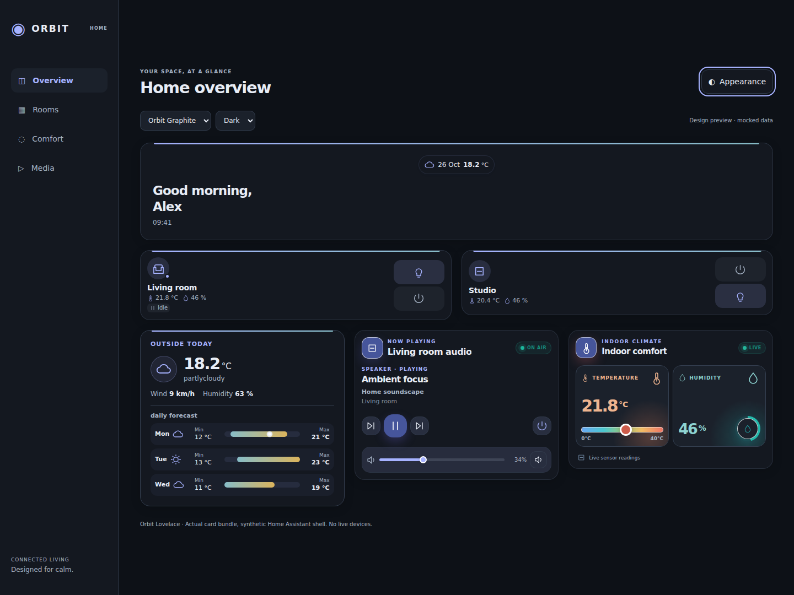

# Orbit Lovelace

**One HACS custom repository. One JavaScript resource. 30 cards.**

Orbit Lovelace packages the Orbit cards and the matching companion card collection into a single, self-contained Home Assistant Dashboard resource. Individual cards keep their existing names, Lovelace types, configurations and controls. This is a distribution suite, not a new all-in-one dashboard card.

Requires **Home Assistant 2026.6.0+** (the strictest native configuration-form API requirement among included cards). No backend integration is installed. There are no dynamic code downloads, CDNs or npm runtime installation requirements. Vacuum Commander's existing Lit runtime is included in the compiled resource.

## Test release: v1.12.0-beta.5 — Compact on all30 cards

Compact is now a small tile with expandable Details, rather than only reduced spacing/fonts. Every included card has an optional **Card layout → Normal / Compact** selector in the prerelease. Welcome Normal restores Settings and collapsible rooms (configured paths retained). Other omitted-layout configurations retain their normal appearance; same single resource and unchanged theme YAML. This beta requires explicit version selection in HACS, not the ordinary stable update. [Install, examples, previews and rollback](docs/COMPACT.md).

## New in v1.11.0: Select and Number

**Select Orbit Card** (`custom:ha-select-orbit-card`) supports `select`/`input_select`; **Number Orbit Card** (`custom:ha-number-orbit-card`) supports `number`/`input_number` with slider, ± and an explicit-Apply box. Matching Orbit design/themes, native visual editor, entity-reported options/limits/step/unit, read-only and truthful service feedback. [Options, examples and safety](docs/CONTROLS.md). Update the suite in HACS and fully reload, then add the cards from the picker; no extra resources or theme YAML update.

## Installation

1. HACS → menu → **Custom repositories**.
2. Add **https://github.com/Liionboy/orbit-lovelace**, category **Dashboard**.
3. Download **Orbit Lovelace** and refresh your browser.
4. Check that Dashboard Resources contains this single resource, type **JavaScript module**:

    /hacsfiles/orbit-lovelace/orbit-lovelace.js

The resource path is **/hacsfiles/orbit-lovelace/orbit-lovelace.js**. If you already installed individual cards, follow [MIGRATION.md](MIGRATION.md) before loading the suite: old standalone resources must not remain enabled alongside it. This repository is a HACS custom repository; default catalog inclusion is not implied.

For manual installation, copy only `dist/orbit-lovelace.js` to `config/www/orbit-lovelace.js` and register `/local/orbit-lovelace.js` as a JavaScript module. Do not register files under `cards/` or `src/` as additional resources.

## Person phone grid fix (v1.10.1)

Person1.1.2 keeps compact readings paired even when two Person cards share a phone row. The old ≤200px stacking rule was too aggressive; compact spacing/icons now adapt to phone half-width cards, with a single-column fallback only for extremely narrow containers≤150px. Complete decimal/unit readings remain visible. Update the suite in HACS and fully reload the phone frontend; existing `metrics_layout: compact` needs no YAML change.

## Desktop / Mobile / iOS Mobile themes (v1.10.0)

Graphite, Fjord and Dune each gain selectable **Desktop**, **Mobile** and **iOS Mobile** profiles, all light/dark. Mobile profiles use optional **card-mod** to hide the ordinary dashboard header below768px while preserving native subview Back and editing. iOS adds system-font/viewport normalization; both mobile profiles respect safe areas and scrolling. Original three theme names remain unchanged. **Theme YAML is a separate manual update**, not installed by HACS Dashboard updates. [Setup, Room/Back example and recovery](docs/themes/DEVICE-PROFILES.md). No live HA/dependency/dashboard changes.

## Person compact paired readings (v1.9.1)

Person Orbit1.1.1 places all compact readings two per row, including extra sensors. Existing `metrics_layout: compact` configurations update automatically; labeled `tiles` remain unchanged. The later v1.10.1 phone fix above retains paired rows at half-phone widths; only extremely narrow containers≤150px stack. Update the suite in HACS and fully reload; do not add a standalone resource.

## Complete Orbit themes (v1.9.0)

**Graphite · Fjord · Dune**, each with native light/dark modes: coordinated HA navigation, canvas, forms/dialog surfaces and optional Orbit accent/surface styling. No card-mod or external assets. **HACS Dashboard updates install the card JS, not the theme YAML**: download the companion file and follow [THEMES.md](THEMES.md) to merge it into your existing theme setup safely. Existing styles remain when no Orbit theme is selected; card types/YAML and semantic state colors are retained. The preview dashboard layout is illustrative, not installed by a theme.



## Media Player mobile feedback (v1.8.0)

Media Player v1.2.5 shows immediate **Sending… → command sent / error** feedback for Turn on and other media commands. Repeated taps cannot duplicate a pending request;15s without an HA response reports an unknown result and never retries automatically. Touch targets survive HA updates until click/change/cancel completes. Player state remains HA-reported. Update the suite in HACS and fully reload the frontend/Companion WebView; no YAML changes or standalone resource needed.

## Current-temperature dot (v1.7.0)

Weather Orbit v1.4.0 automatically marks the weather entity’s current temperature with a contrasting dot on **today’s daily forecast bar**. It follows the same resolved date/time zone and shared range scale, never the separate outdoor sensor. If current weather exceeds forecast endpoints the scale expands, without changing Min/Max. No dot for missing today/invalid data. Update the suite in HACS, fully reload, select daily/bars; no new configuration needed.

## Daily forecast update (v1.6.0)

Weather Orbit v1.3.0 adds **Daily forecast layout → bars** (or `forecast_type: daily`, `forecast_layout: bars`) for horizontal daily minimum–maximum ranges. Existing tiles stays default. Min/max come from the provider, not the separate outdoor sensor; missing values are not estimated. Update Orbit Lovelace in HACS and fully reload; no standalone resource needed.

## Room update (v1.5.0)

Room Orbit v1.6.0 accepts **any entity domain** in the four shortcut slots, including all binary sensors, people, media players, vacuums, helpers and custom integrations. Binary icons follow device class/state. Existing direct light/switch/helper/fan and cover controls remain; other types open native More Info only, without inferred services. Humidifiers/dehumidifiers remain supported in **Room climate / humidifier**. Existing YAML remains valid. Update this suite in HACS, fully reload, then select your entities in Room’s editor. No additional standalone resource is needed.

## Included cards

- **Orbit:** Alerts, Battery, Fan, NAS, Person, Room, Scenes, Sensor Graph, Server, Speedtest, UniFi Orbit + UniFi Command Center, Weather and Welcome.
- **Companion collection:** Action Button, AlecoAir Dehumidifier, Animated Gate, Climate Control, Frigate Control, Home Connect Washer, HP Printer, Luma Control, Pi-hole Control, Sensor Meter, Switch Control, Media Player, Temperature & Humidity and Vacuum Commander.

There are **27 source packages and 28 distinct cards**, plus the legacy `living-temperature-card` alias. NAS remains a separate UGREEN-oriented card; Server remains independently configurable. This packaging does not add functionality or device support to the included cards.

See [CATALOG.md](CATALOG.md) for exact included versions, existing Lovelace types and each card's configuration reference. For example, your existing `type: custom:ha-person-orbit-card` remains unchanged, including the v1.1.0 optional readings/compact layout.

## Compatibility and safety

- Suite releases update the collection together. Component versions are pinned in `components.json`; they are independent of the suite version.
- Loading the suite only registers cards; it does not instantiate them or call device services. Configured cards retain their original behavior, including state/API requests, local camera images and explicit controls.
- Existing standalone registrations are not overwritten. They are skipped and reported in `window.orbitLovelace.skipped`. This prevents duplicate definitions, **not** live upgrading: remove old resources and perform a full frontend reload to use the bundled version.
- Temperature & Humidity's legacy alias now uses a distinct subclass, fixing its duplicate-constructor registration error. Its stale version banner is corrected in the bundle; both existing types are retained. Since suite v1.1.0, Weather Orbit includes the current clock and calendar date by default; both are configurable. Suite v1.2.0 adds an optional measured outdoor temperature sensor to Weather Orbit, displayed separately from the weather provider (`outdoor_temperature_entity`). Suite v1.3.0 adds Welcome Orbit v1.1.0 with opt-in compact layout, collapsible quick navigation, top weather/date chip and an explicit optional settings route. Other card functionality remains unchanged.
- HA native components, the actual native configuration editors, physical devices and Companion apps require user-side validation. Offline/browser mocks do not certify live HA compatibility.

## Development

Node.js 22+; no install step or build dependencies:

```sh
npm run build
npm run check
npm test
PLAYWRIGHT_MODULE=/path/to/playwright-core/index.mjs CHROMIUM_EXECUTABLE=/path/to/chromium npm run test:browser
```

All tests are run **sequentially**, including upstream suites. Browser tests require an existing Playwright/Chromium installation and operate only on mocked Home Assistant data. Use `SCREENSHOT_DIR` to save screenshots outside the repository.

The deterministic build verifies source digests, applies the documented packaging/compatibility transformations and writes the single distributable. No network access is required for build/test. See [AUDIT.md](AUDIT.md) for scope/provenance and [THIRD_PARTY_NOTICES.md](THIRD_PARTY_NOTICES.md) for licensing.
