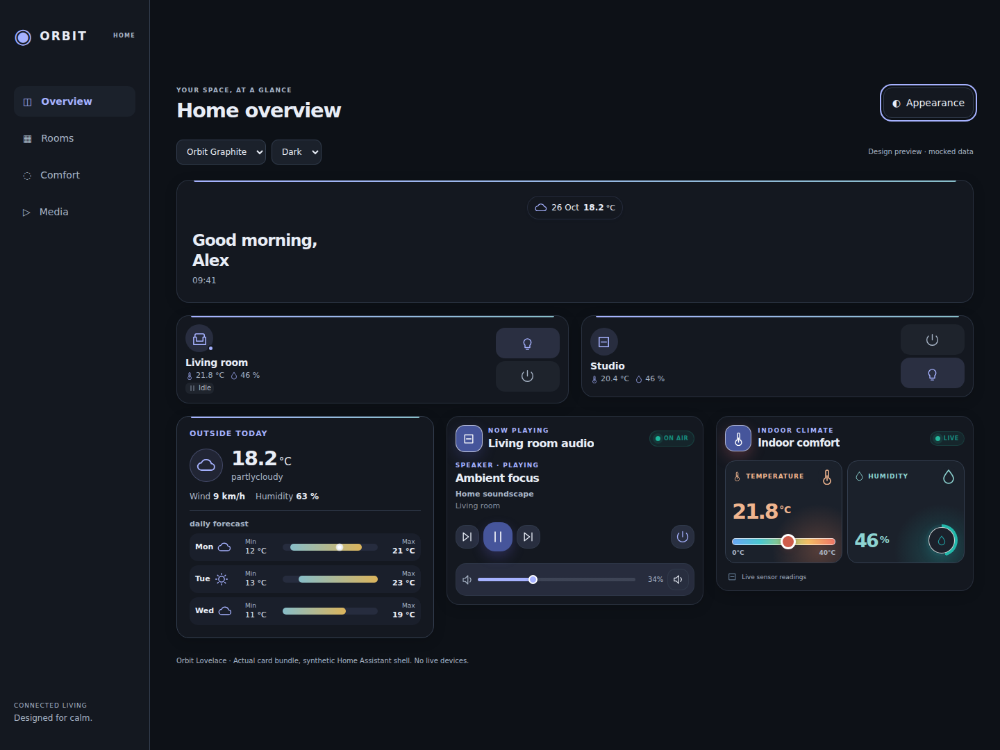

# Orbit Lovelace

**One HACS custom repository. One JavaScript resource. 37 cards.**

Orbit Lovelace packages the Orbit cards and the matching companion card collection into a single, self-contained Home Assistant Dashboard resource. Individual cards keep their existing names, Lovelace types, configurations and controls. This is a distribution suite, not a new all-in-one dashboard card.

Requires **Home Assistant 2026.6.0+** (the strictest native configuration-form API requirement among included cards). No backend integration is installed. There are no dynamic code downloads, CDNs or npm runtime installation requirements. Vacuum Commander's existing Lit runtime is included in the compiled resource.

## Fixed in v1.21.1 — Stable Bambu scrolling

Bambu Print model previews and Bambu Camera keep their 16:9 space while the media player is released offscreen or in a hidden tab. Pausing/reloading media no longer collapses the dashboard around the scroll position. Status messages also reserve space at phone/narrow widths; Compact still hides closed Details completely. Same YAML and resource: update in HACS and fully reload the phone frontend. [Scope and verification](docs/BAMBU.md#mobile-scroll-stability). No live dashboard, printer, theme or resource changes.

## Added in v1.21.0 — Bambu Orbit cards and dashboard

Three suite-owned cards: **Bambu Print**, **Bambu AMS** and **Bambu Camera**, with the Orbit palettes, native visual forms and Normal/Compact. Reported job/progress/layers/ETA, actual/target dual-nozzle/bed/chamber temperatures, visible HMS alerts, four AMS trays and native HA camera/model previews. [Full configuration and limits](docs/BAMBU.md) · [Complete responsive dashboard YAML](examples/bambu-dashboard.yaml). Existing Temperature/Gauge/Chips supply history, cooling percentages and light/camera controls. Monitoring-first: no printer movement/G-code/start/pause commands. Same HACS resource; update + reload, no new backend/dependency/theme update/restart.37 cards/33 packages; previous34 implementations and Themes1.2.0 unchanged.

## Fixed in v1.20.1 — Chip content breathing room

Chips keep their left/start alignment, slim capsules and12px text, but the icon/text no longer hug the left border. Normal/Compact use12px horizontal padding; narrow separate cards adapt from4px to12px instead of the previous2px, preserving space for readable labels. No centering, visibility/action changes or HA configuration changes. [Spacing evidence and previews](docs/CHIPS.md#content-inset). Same HACS resource; update + full frontend reload.

## Added in v1.20.0 — Title Orbit Card

**Title Orbit Card** (`custom:ha-title-orbit-card`) is a lightweight section heading: title, optional subtitle/plain icon, Orbit palettes, logical alignment, optional subtle divider and semantic heading level. Transparent/unframed, native visual form and Normal/Compact; no entities, services or queries. [Configuration and phone previews](docs/TITLE.md). Same HACS resource; update + full reload, no theme YAML update or HA restart. The suite now contains34 cards from32 packages, including five suite-owned modules.

## Added in v1.19.2 — Slim capsule design

Chips now use a slim **36px visible capsule in Compact** (40px Normal), plain icons without a colored disc,12px single-line text and a light border. The actual button remains at least44px tall for touch. Existing name/state visibility choices are retained; `show_state: false` still hides helper On/Off text. [Preview and configuration](docs/CHIPS.md#slim-capsule-design). Same HACS resource; update and fully reload. No HA/dashboard/theme changes.

## Fixed in v1.19.1 — Phone-sized chips

Fixes chips breaking `Closed`, helper names and alarm states into vertical fragments in narrow phone columns, including Compact. Whole pills wrap as units in a collection; separate narrow cards adapt their icon/spacing and use at most two unbroken label rows. At least44px touch targets, unchanged actions and Alarm safeguards. Update HACS and fully reload the phone frontend; existing YAML works. [Before/after and sizing](docs/CHIPS.md#mobile-sizing).

## Added in v1.19.0 — Alarm chips

Chips Orbit now includes a dedicated **Alarm chip**: state-aware shield icons, neutral Disarmed, blue Armed modes, amber Arming/Disarming/Entry delay and red Triggered with a subtle reduced-motion-aware pulse. **Add alarm chip** in the Chips visual editor filters the entity picker to `alarm_control_panel`. Tap opens native HA controls and any required code prompt; the chip does not arm/disarm directly, store a PIN or invent a countdown. Existing alarm entities gain the state presentation automatically. [Example and safety boundaries](docs/CHIPS.md#alarm-chip). Update the same HACS suite and fully reload; no new resource/theme YAML or HA restart.

## Added in v1.18.0 — Chips Orbit Card

**Chips Orbit Card** (`custom:ha-chips-orbit-card`) is a wrapping row of small Orbit pills: reported states/sensor values, native More Info, explicit light/switch/input_boolean power controls and local navigation. Per-chip icon/name/palette, optional icon-only display, alignment and read-only; visual add/remove/reorder editor, Normal/Compact and44px minimum targets. No outer card frame, aggregate tile or hidden chip list. [Configuration, previews and safety](docs/CHIPS.md). Same suite/resource; HACS update + full reload, no theme YAML update or live HA changes.

## New in v1.17.0 — Orbit Prism theme

**Orbit Prism** adds expressive native card gradients, violet/cyan accents, ink-blue dark surfaces and crisp light surfaces, while preserving explicit palettes and semantic state colors. Light/dark and Desktop/Mobile/iOS Mobile; original Graphite/Fjord/Dune definitions unchanged. **Theme YAML is updated separately from HACS Dashboard JavaScript.** [Installation and previews](THEMES.md#orbit-prism). No live HA changes.

## New in v1.16.0 — Gauge Orbit Card

A dedicated **semicircular gauge** for numeric sensors, including RPM: fine tick marks, endpoint indicator, large actual reading, explicit scale and source, native visual editor, Orbit palettes and Normal/Compact. No guessed RPM limits, alarm zones, device commands or polling. [Configuration and previews](docs/GAUGE.md). Update the existing suite in HACS and fully reload; same resource.

## New in v1.15.0 — Temperature Orbit Card

A dedicated **temperature-only** card: large reported reading, recorded history graph, min/max, optional icon and Orbit palette, native visual editor, Normal/Compact. No humidity or thermostat controls. Add `custom:ha-temperature-orbit-card` from the same suite. [Configuration and previews](docs/TEMPERATURE.md). Update Orbit in HACS and fully reload; no additional resource or theme update.

## New in v1.14.0 — Frigate camera playback

Frigate Control Card no longer leaves a static snapshot frozen until page reload. Choose native HA live playback (default), auto-refreshed snapshot, or go2rtc MP4 preview through the authenticated Frigate integration proxy. Preview survives sensor updates and unloads when hidden/Compact closed. [Configuration, transport limits and migration](docs/FRIGATE-LIVE.md). Same resource; update Orbit in HACS and fully reload.

## New in v1.13.1 — Switch icon color follows state

Switch Control Card uses its palette color for the identity icon only when HA reports **ON**. OFF/unknown/unavailable stay neutral, in Normal and Compact. No new YAML; commands, telemetry and the rest of the styling stay unchanged. [Preview and details](docs/SWITCH-STATE-ICON.md). Update Orbit in HACS and fully reload.

## New in v1.13.0 — Luma icon and palette per card

Luma now provides optional **Icon** and **Orbit palette** in its native form/YAML, for lights/switches and Normal/Compact. Choose Auto/Aurora/Ocean/Sunset/Lavender; Auto and an empty icon retain old behavior. No color command or entity metadata change: real light RGB and semantic states remain intact. Update Orbit in HACS and fully reload; [configuration and preview](docs/LUMA-APPEARANCE.md).

## Fixed in v1.12.2 — one Compact identity across the suite

Switch Control Card no longer repeats its name/state header above its power button and telemetry. The expanded-identity audit now covers all30 card types: redundant source titles stay hidden, while native More Info/Room details controls and unique readings/notes remain accessible. Normal, commands, configuration and themes are unchanged. Update Orbit in HACS and fully reload; no YAML changes. [Scope and preview](docs/COMPACT.md).

## Fixed in v1.12.1 — Compact Light identity

Luma Control Card (light/switch) now shows its name/icon/reported state only once in Compact, including expanded Details. The original redundant header stays hidden, while native controls and feedback remain intact. Cards without secondary content no longer show an empty Details arrow. Normal and all other card profiles are unchanged. Update in HACS and fully reload; no YAML or theme change.

## New in v1.12.0 — Compact tiles and clearer Welcome

**Stable promotion of v1.12.0-beta.5, with no additional functional changes.** Every included card has an optional **Card layout → Normal / Compact** selector. Compact is a small tile with expandable Details and native primary commands, not merely reduced fonts. Welcome Normal keeps Settings and collapsible rooms and adds a24px bold clock and16px semibold date. Configured routes and other omitted-layout appearances are retained. Update Orbit Lovelace to **v1.12.0** in HACS and fully reload the frontend; same single resource, no YAML or theme update required. Existing beta.5 configurations work unchanged. [Install, examples, previews and rollback](docs/COMPACT.md).

## New in v1.11.0: Select and Number

**Select Orbit Card** (`custom:ha-select-orbit-card`) supports `select`/`input_select`; **Number Orbit Card** (`custom:ha-number-orbit-card`) supports `number`/`input_number` with slider, ± and an explicit-Apply box. Matching Orbit design/themes, native visual editor, entity-reported options/limits/step/unit, read-only and truthful service feedback. [Options, examples and safety](docs/CONTROLS.md). Update the suite in HACS and fully reload, then add the cards from the picker; no extra resources or theme YAML update.

## Installation

1. HACS → menu → **Custom repositories**.
2. Add **https://github.com/Liionboy/orbit-lovelace**, category **Dashboard**.
3. Download **Orbit Lovelace** and refresh your browser.
4. Check that Dashboard Resources contains this single resource, type **JavaScript module**:

    /hacsfiles/orbit-lovelace/orbit-lovelace.js

The resource path is **/hacsfiles/orbit-lovelace/orbit-lovelace.js**. If you already installed individual cards, follow [MIGRATION.md](MIGRATION.md) before loading the suite: old standalone resources must not remain enabled alongside it. This repository is a HACS custom repository; default catalog inclusion is not implied.

For manual installation, copy only `dist/orbit-lovelace.js` to `config/www/orbit-lovelace.js` and register `/local/orbit-lovelace.js` as a JavaScript module. Do not register files under `cards/` or `src/` as additional resources.

## Person phone grid fix (v1.10.1)

Person1.1.2 keeps compact readings paired even when two Person cards share a phone row. The old ≤200px stacking rule was too aggressive; compact spacing/icons now adapt to phone half-width cards, with a single-column fallback only for extremely narrow containers≤150px. Complete decimal/unit readings remain visible. Update the suite in HACS and fully reload the phone frontend; existing `metrics_layout: compact` needs no YAML change.

## Desktop / Mobile / iOS Mobile themes (v1.10.0)

Graphite, Fjord and Dune each gain selectable **Desktop**, **Mobile** and **iOS Mobile** profiles, all light/dark. Mobile profiles use optional **card-mod** to hide the ordinary dashboard header below768px while preserving native subview Back and editing. iOS adds system-font/viewport normalization; both mobile profiles respect safe areas and scrolling. Original three theme names remain unchanged. **Theme YAML is a separate manual update**, not installed by HACS Dashboard updates. [Setup, Room/Back example and recovery](docs/themes/DEVICE-PROFILES.md). No live HA/dependency/dashboard changes.

## Person compact paired readings (v1.9.1)

Person Orbit1.1.1 places all compact readings two per row, including extra sensors. Existing `metrics_layout: compact` configurations update automatically; labeled `tiles` remain unchanged. The later v1.10.1 phone fix above retains paired rows at half-phone widths; only extremely narrow containers≤150px stack. Update the suite in HACS and fully reload; do not add a standalone resource.

## Complete Orbit themes (v1.9.0)

**Graphite · Fjord · Dune**, each with native light/dark modes: coordinated HA navigation, canvas, forms/dialog surfaces and optional Orbit accent/surface styling. No card-mod or external assets. **HACS Dashboard updates install the card JS, not the theme YAML**: download the companion file and follow [THEMES.md](THEMES.md) to merge it into your existing theme setup safely. Existing styles remain when no Orbit theme is selected; card types/YAML and semantic state colors are retained. The preview dashboard layout is illustrative, not installed by a theme.



## Media Player mobile feedback (v1.8.0)

Media Player v1.2.5 shows immediate **Sending… → command sent / error** feedback for Turn on and other media commands. Repeated taps cannot duplicate a pending request;15s without an HA response reports an unknown result and never retries automatically. Touch targets survive HA updates until click/change/cancel completes. Player state remains HA-reported. Update the suite in HACS and fully reload the frontend/Companion WebView; no YAML changes or standalone resource needed.

## Current-temperature dot (v1.7.0)

Weather Orbit v1.4.0 automatically marks the weather entity’s current temperature with a contrasting dot on **today’s daily forecast bar**. It follows the same resolved date/time zone and shared range scale, never the separate outdoor sensor. If current weather exceeds forecast endpoints the scale expands, without changing Min/Max. No dot for missing today/invalid data. Update the suite in HACS, fully reload, select daily/bars; no new configuration needed.

## Daily forecast update (v1.6.0)

Weather Orbit v1.3.0 adds **Daily forecast layout → bars** (or `forecast_type: daily`, `forecast_layout: bars`) for horizontal daily minimum–maximum ranges. Existing tiles stays default. Min/max come from the provider, not the separate outdoor sensor; missing values are not estimated. Update Orbit Lovelace in HACS and fully reload; no standalone resource needed.

## Room update (v1.5.0)

Room Orbit v1.6.0 accepts **any entity domain** in the four shortcut slots, including all binary sensors, people, media players, vacuums, helpers and custom integrations. Binary icons follow device class/state. Existing direct light/switch/helper/fan and cover controls remain; other types open native More Info only, without inferred services. Humidifiers/dehumidifiers remain supported in **Room climate / humidifier**. Existing YAML remains valid. Update this suite in HACS, fully reload, then select your entities in Room’s editor. No additional standalone resource is needed.

## Included cards

- **Orbit:** Alerts, Battery, Fan, NAS, Person, Room, Scenes, Sensor Graph, Server, Speedtest, UniFi Orbit + UniFi Command Center, Weather and Welcome.
- **Companion collection:** Action Button, AlecoAir Dehumidifier, Animated Gate, Climate Control, Frigate Control, Home Connect Washer, HP Printer, Luma Control, Pi-hole Control, Sensor Meter, Switch Control, Media Player, Temperature & Humidity and Vacuum Commander.

The **27 imported source packages provide 28 original cards**; three suite-owned modules add Select, Number, Temperature and Gauge, for **32 card types / 30 packages**, plus the legacy `living-temperature-card` alias. NAS remains a separate UGREEN-oriented card; Server remains independently configurable. Imported inputs remain pinned; suite additions and adaptations have separate provenance.

See [CATALOG.md](CATALOG.md) for exact included versions, existing Lovelace types and each card's configuration reference. For example, your existing `type: custom:ha-person-orbit-card` remains unchanged, including the v1.1.0 optional readings/compact layout.

## Compatibility and safety

- Suite releases update the collection together. Component versions are pinned in `components.json`; they are independent of the suite version.
- Loading the suite only registers cards; it does not instantiate them or call device services. Configured cards retain their original behavior, including state/API requests, local camera images and explicit controls.
- Existing standalone registrations are not overwritten. They are skipped and reported in `window.orbitLovelace.skipped`. This prevents duplicate definitions, **not** live upgrading: remove old resources and perform a full frontend reload to use the bundled version.
- Temperature & Humidity's legacy alias now uses a distinct subclass, fixing its duplicate-constructor registration error. Its stale version banner is corrected in the bundle; both existing types are retained. Since suite v1.1.0, Weather Orbit includes the current clock and calendar date by default; both are configurable. Suite v1.2.0 adds an optional measured outdoor temperature sensor to Weather Orbit, displayed separately from the weather provider (`outdoor_temperature_entity`). Suite v1.3.0 adds Welcome Orbit v1.1.0 with opt-in compact layout, collapsible quick navigation, top weather/date chip and an explicit optional settings route. Other card functionality remains unchanged.
- HA native components, the actual native configuration editors, physical devices and Companion apps require user-side validation. Offline/browser mocks do not certify live HA compatibility.

## Development

Node.js 22+; no install step or build dependencies:

```sh
npm run build
npm run check
npm test
PLAYWRIGHT_MODULE=/path/to/playwright-core/index.mjs CHROMIUM_EXECUTABLE=/path/to/chromium npm run test:browser
```

All tests are run **sequentially**, including upstream suites. Browser tests require an existing Playwright/Chromium installation and operate only on mocked Home Assistant data. Use `SCREENSHOT_DIR` to save screenshots outside the repository.

The deterministic build verifies source digests, applies the documented packaging/compatibility transformations and writes the single distributable. No network access is required for build/test. See [AUDIT.md](AUDIT.md) for scope/provenance and [THIRD_PARTY_NOTICES.md](THIRD_PARTY_NOTICES.md) for licensing.
