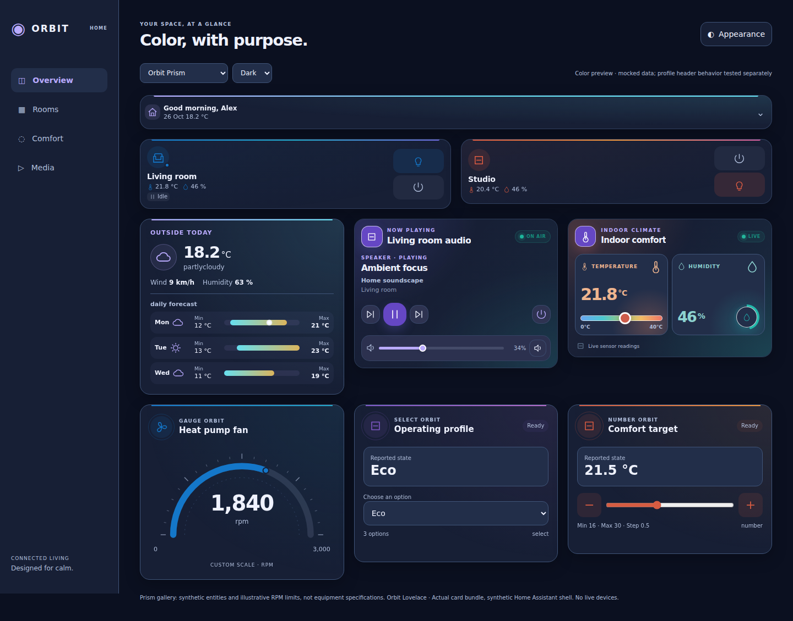
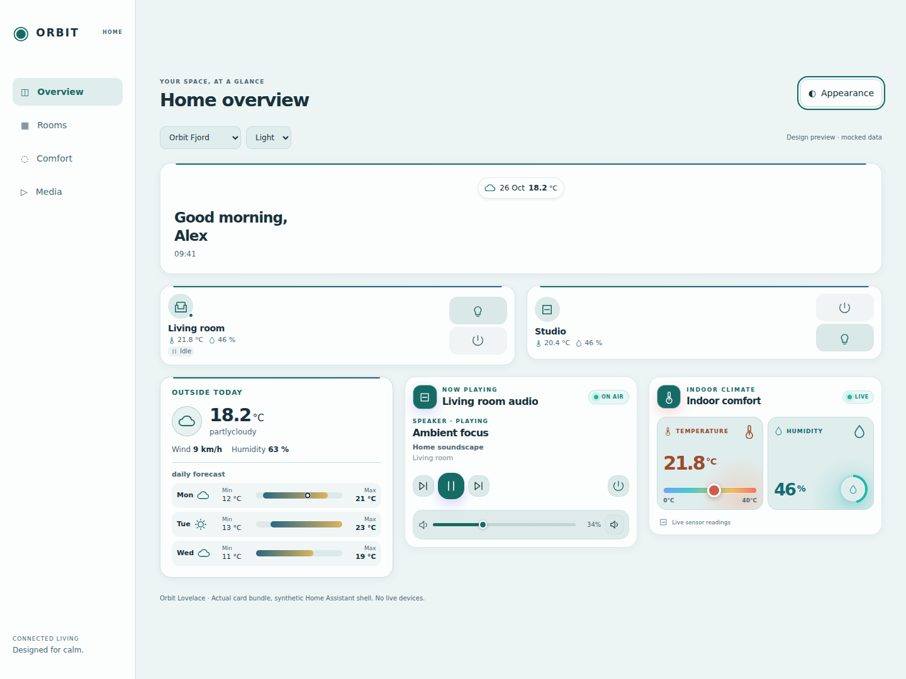
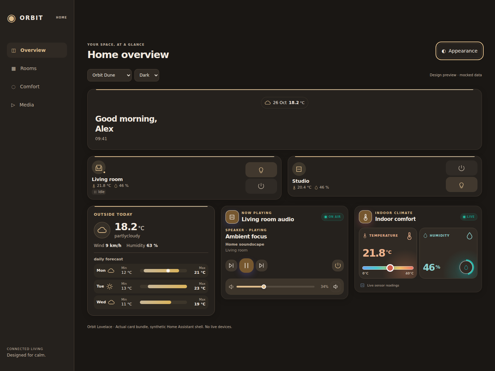

# Orbit Themes

Four complete Home Assistant theme families, each with native **light and dark modes**. Current definitions **1.2.0** in suite **1.17.0** add expressive **Orbit Prism** alongside **Desktop, Mobile and iOS Mobile** profiles. Original names/styles remain unchanged. [Device profiles, card-mod, Room/Back navigation and recovery](docs/themes/DEVICE-PROFILES.md).

- **Orbit Prism** — expressive native card gradients, precise violet/cyan accents and layered ink-blue surfaces. Recommended for more visible card colors.
- **Orbit Graphite** — architectural graphite neutrals and restrained indigo.
- **Orbit Fjord** — deep petrol/soft cool surfaces with muted teal.
- **Orbit Dune** — warm stone, sand and quiet bronze.

Themes cover the dashboard canvas, HA header/sidebar, card surfaces, text, forms, sliders and dialog surfaces through native frontend variables, with legacy and newer semantic token mappings. Original families and Desktop need no card-mod. Mobile/iOS Mobile use optional **card-mod** root CSS for phone header behavior. No external fonts/images or theme JavaScript downloads. HA frontend tokens outside primary/accent/state color are version-dependent; not every third-party card honors them.

## Important: two separate installation steps

**Updating the Dashboard plugin in HACS installs the card JavaScript, not these theme YAML definitions.** Keep the one Orbit resource; do not install the same repository a second time as a Theme or add standalone cards alongside it. The YAML below is an optional manual companion download from this same repository. No separate repository was created.

1. **Update Orbit Lovelace to v1.17.0 or later in HACS** and fully reload each frontend/Companion WebView. This enables the optional Orbit accent/surface bridge. Native HA theme colors also work without the bridge, but some old Orbit accents will remain.
2. Back up your HA configuration and existing themes. Download [orbit-themes.yaml](https://github.com/Liionboy/orbit-lovelace/releases/download/v1.17.0/orbit-themes.yaml) and save the complete, unchanged file as **`/config/themes/orbit-themes.yaml`**. It contains all16 names/32 modes; replace the old Orbit file rather than adding a duplicate; do not paste it into a Lovelace card or JavaScript resource. Keep your other theme files.
3. If you already use `themes: !include_dir_merge_named themes` under `frontend:`, no configuration edit is needed. Otherwise **merge** the theme inclusion into the existing frontend configuration, never add a duplicate `frontend:` section or replace its other settings:

```yaml
frontend:
  # Keep all existing frontend settings here.
  themes: !include_dir_merge_named themes
```

If your existing `frontend.themes` uses `!include themes.yaml`, another directory or inline definitions, preserve that arrangement and merge the theme entries into its included mapping, or migrate it only after backing up and preserving every existing theme. Do not blindly replace an existing themes key.

4. If themes were already enabled, run **Developer Tools → Actions → `frontend.reload_themes`**. If this is your first time enabling themes/changing the frontend include, validate configuration and restart HA at a time you choose; no restart or live change has been performed by this project.
5. In **your user profile → Appearance**, select **Orbit Prism** (recommended: Dark), **Orbit Graphite**, **Orbit Fjord** or **Orbit Dune**, then choose Light, Dark or automatic/system mode. The theme supplies both modes. Refresh the phone frontend if old assets remain cached. A per-user selection is preferable to changing everyone’s global default.

## What changes in Orbit cards?

The suite’s build-only theme bridge adds CSS-variable fallbacks without editing any pinned upstream assets. Default/base palette accents, root card radius/shadow, decorative surfaces and selected companion-card branding use optional `orbit-theme-*` tokens. No theme selected means the previous styles remain; representative populated-card computed colors/geometry were compared against v1.8.0.

- Default/aurora accents follow the active theme. Explicit alternate palettes retain their local accent variables; shared decorative surfaces remain coordinated with the theme.
- Heating/cooling, warm/cold room effects, alarm/error/unavailable indicators, actual light RGB values, forecast scales and data-specific chart colors are not recolored into generic branding. Temperature/humidity panels keep distinct semantic hues, adapted to light/dark surfaces. Some device/data-specific colors deliberately differ from the theme accent.
- Switching theme/mode updates CSS without replacing card controls or requesting more entity/forecast data. Card types, entity selections, YAML and services are unchanged.
- Existing card layout/spacing and configured sizing are retained. A theme does **not** create the preview dashboard layout or add navigation/views/entities. Card-mod, inline dashboard CSS or other custom themes can override these variables.

## Orbit Prism

Prism deliberately **does not neutralize native card backgrounds, decorative overlays or accent stripes**. Each card resolves its own palette gradients instead of a theme-scope gradient forcing every card to the same accent. Stronger violet/cyan accents, a cool canvas and layered shadows frame those colors without replacing semantic states. Cards without decorative gradients do not gain invented device colors. Explicit Ocean/Sunset/Lavender palettes remain as configured; selecting a theme does not rewrite card YAML or choose a different palette.

Choose **Orbit Prism** or **Orbit Prism Desktop** for the regular native HA header. Mobile/iOS Mobile share the colors and existing optional card-mod behavior; see [device profiles](docs/themes/DEVICE-PROFILES.md). Card-mod is not needed for Prism colors.

Update the existing optional theme YAML with the preserve/merge steps above, reload themes, select Prism in your profile and fully refresh. HACS Dashboard updates **do not copy the YAML**. Existing bridge support is sufficient; no new runtime dependency, dashboard recreation or HA restart is needed if themes are already configured.



[Light](docs/themes/images/orbit-prism-light-desktop.png) · [Dark phone](docs/themes/images/orbit-prism-dark-phone.png) · [Light phone](docs/themes/images/orbit-prism-light-phone.png).

Local interactive gallery: serve the repository root and open `docs/themes/preview.html?gallery=prism`. The layout, illustrative RPM limits and example entities are demonstration only, not installed by a theme.

## Previews

Actual released card code with mocked entities inside a **synthetic HA-like shell**, not a capture of a live HA instance. Preview icons are local SVG stubs, not certification of native HA components.

### Graphite


[Light](docs/themes/images/orbit-graphite-light-desktop.png) · [Phone](docs/themes/images/orbit-graphite-dark-phone.png) · [Dialog token preview](docs/themes/images/orbit-graphite-dark-dialog.png)

### Fjord


[Dark](docs/themes/images/orbit-fjord-dark-desktop.png) · [Phone](docs/themes/images/orbit-fjord-light-phone.png)

### Dune


[Light](docs/themes/images/orbit-dune-light-desktop.png) · [Phone](docs/themes/images/orbit-dune-dark-phone.png)

The optional local design preview is `docs/themes/preview.html`, served from this repository root over HTTP. It only reads the local catalog and bundle, uses mocked service functions, and cannot operate real devices. It is not an HA dashboard resource; do not add preview JavaScript to HA.

## Rollback

Choose your previous/default theme in the profile; Orbit variables stop applying and default card styling returns. If desired, remove only the new `orbit-themes.yaml` file **after** deselecting it, then reload themes. Preserve other files/configuration. The suite JavaScript/resource can remain installed; it does not force a theme. Revert to an older suite release only if you also want to remove the bridge code.

## Verification boundaries

Generated YAML parsed by a real YAML parser and matched to the catalog; deterministic build, source pins, core color-pair contrast (normal text >=4.5:1, primary text on card >=7:1), accessible action colors and no external dependencies tested. These are specific token-pair checks, **not a full WCAG certification of every card/state/chart**.

Themes1.2.0 verification:740 Node tests plus two upstream smoke suites, real YAML parsing, all12 original definitions hash-matched to1.1.0, and all32 card runtime code byte-identical to suite1.16.0 after two version strings. Chromium:1,024 theme/card mounts across32 modes,2,048 populated Normal/Compact theme mounts,96 two-card phone grids; dedicated Prism gallery in8 profile/modes at1440/768/390px, normal/compact screenshots, stable controls/no extra queries, local-palette and warm-state precedence, exact Select/Number payloads, rollback and real card-mod header/Back/edit tests.

Native HA profile selection, stock dialogs/editors, physical Companion/Safari and every legacy/device-specific state remain unverified. Mocked icons/data and a synthetic HA shell were used, not a live dashboard. No live HA configuration, dashboard, theme selection, resource or device was changed.
