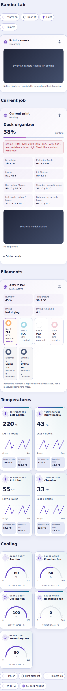
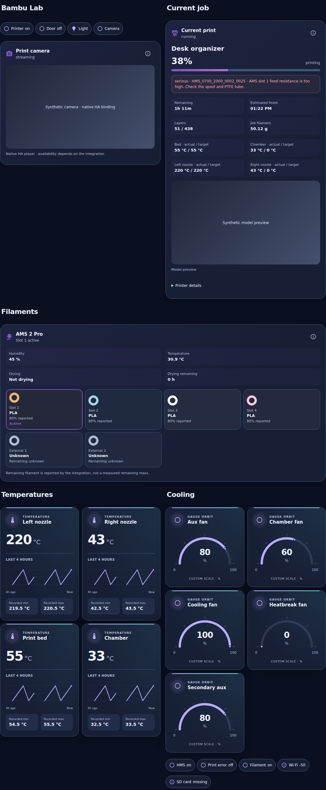

# Bambu Orbit cards and dashboard

Suite-owned **Bambu Orbit1.0.0**, included in **Orbit Lovelace1.21.0+**. Three cards in the same HACS resource:

- `custom:ha-bambu-print-orbit-card` — reported job/progress/layers/remaining/ETA, current and target temperatures, model preview, visible HMS/print-error warnings and expandable diagnostics.
- `custom:ha-bambu-ams-orbit-card` — up to four AMS trays and two optional external spools, reported material/RGBA color/active/remaining percentage, humidity/temperature/drying status.
- `custom:ha-bambu-camera-orbit-card` — native Home Assistant camera preview in an Orbit frame, live or auto snapshot mode. No printer-specific camera URL or credentials.

All three have a native visual configuration form, custom title/icon, Aurora/Ocean/Sunset/Lavender palettes and Normal/Compact. Print/Camera Compact use summary + Details; alerts remain visible even with Details closed. AMS keeps every spool visible instead of hiding the collection behind a single synthetic tile.

## Install

Update **Orbit Lovelace** in HACS, then fully reload each frontend/Companion app. Add any of the three cards by name. Same resource: `/hacsfiles/orbit-lovelace/orbit-lovelace.js`. No extra resource, standalone repository, theme update, backend integration or HA restart. Existing Bambu Lab integration must supply the entities; these frontend cards do not connect directly to the printer.

## Dashboard

[Complete generic dashboard YAML](../examples/bambu-dashboard.yaml) (JSON syntax is valid YAML). Replace `my_bambu` with your actual entity prefix and verify every ID. Keep manual overrides for renamed entities. The owner-specific file is delivered privately, not published with a printer serial number.

Create a **new** empty dashboard in Home Assistant, open its Raw configuration editor, back up its current configuration, and paste the template. Do not paste over a populated dashboard unless you intend to replace it and have a backup. Native Sections layout uses at most two columns; Home Assistant adapts it on phones. The generic template includes:

1. Title + status/light/camera chips and camera panel.
2. Current job, layers/ETA/progress, actual/target temperatures and HMS diagnostics.
3. AMS2Pro-style four-slot collection and optional external spools.
4. Four existing Temperature Orbit cards (four-hour Recorder graphs).
5. Five existing Gauge Orbit cards with explicit0–100% fan scales, and diagnostic Chips.

Only the Light and Camera chips have explicit native power actions, guarded by existing Chips availability/read-only/service/pending protections. Status/alert chips open More Info. Set `read_only: true` on the control Chips collection or remove its toggle actions if you want a monitoring-only dashboard. Read-only UI controls do not revoke permissions in native HA dialogs.

No optional Orbit theme or third-party layout dependency is required. Prism is optional and installed separately as documented in THEMES.md. The generated template does not select a theme or alter existing resources.

## Print card

default example:

	type: custom:ha-bambu-print-orbit-card
	entity: sensor.my_bambu_print_status
	palette: lavender

For the integration’s standard `sensor.<prefix>_print_status` naming, siblings are resolved by that exact prefix. No fuzzy device discovery or whole-system subscriptions. Renamed IDs require explicit fields. An empty optional field disables that sibling, including `preview_entity: ""` to suppress the model image.

Sensor overrides: `progress_entity`, `stage_entity`, `task_entity`, `remaining_entity`, `end_time_entity`, `current_layer_entity`, `total_layers_entity`, `weight_entity`, `length_entity`, `bed_entity`, `bed_target_entity`, `chamber_entity`, `chamber_target_entity`, `left_nozzle_entity`, `left_target_entity`, `right_nozzle_entity`, `right_target_entity`, `active_tray_entity`, `speed_entity`. Binary overrides: `online_entity`, `hms_entity`, `print_error_entity`, `door_entity`. `preview_entity` accepts an `image.*` entity (default cover_image).

Progress is the integration’s percentage, never calculated from layers; valid0–100 controls the bar. Out-of-range values stay visible but unscaled. Layers and job weight/length remain reported values, not computed estimates. Remaining duration supports h/min/s; ETA uses the configured HA time zone, with no running countdown or synthetic advancement. Temperature units remain as reported, with no implicit conversion. Older single-nozzle printers can override left/right fields but are not given invented second-nozzle capabilities.

HMS and print_error are independent. At most20 indexed HMS messages are shown as safe text, including supplied code/severity. Unknown/missing configured alert sensors do not mean all-clear. Printer offline or disconnected HA retains labelled last reports with a neutral progress bar; it does not infer print completion. Diagnostic More Info targets the actual print status sensor.

## AMS card

	type: custom:ha-bambu-ams-orbit-card
	title: AMS 2 Pro
	tray_entities:
	  - sensor.my_bambu_ams_1_tray_1
	  - sensor.my_bambu_ams_1_tray_2
	  - sensor.my_bambu_ams_1_tray_3
	  - sensor.my_bambu_ams_1_tray_4
	external_spool_entities:
	  - sensor.my_bambu_externalspool_external_spool
	  - sensor.my_bambu_externalspool2_external_spool

Unique arrays, at most four trays/two external spools. Optional `humidity_entity`, `temperature_entity`, `drying_entity`, `remaining_drying_time_entity` and `online_entity` are editable. Standard first-tray naming resolves the AMS environmental siblings and printer online sensor; custom IDs need overrides.

Slot order follows the configured array. Tapping any slot opens native More Info for that exact sensor — it does **not** load/unload filament or edit its material. Colors accept only #RRGGBB/#RRGGBBAA, not arbitrary CSS. Unknown/empty filaments are neutral. A percentage is shown only for a known, nonempty spool with boolean `remain_enabled: true` and a finite numeric0–100 `remain` value. `tray_weight` is deliberately not treated as measured remaining grams; reported100% is not certified spool weighing. Offline data is labelled and active highlights removed. No guessed dry-completion countdown or drying command is added.

## Camera card

	type: custom:ha-bambu-camera-orbit-card
	entity: camera.my_bambu_camera
	camera_view: live

`camera_view: live|auto` (default live). Native HA `hui-image` handles authenticated HLS/WebRTC/snapshot choices supported by the installed integration/browser. The card does not claim a frame rate, audio or that a reported `streaming` state proves playback. Native media is mounted only while the card is connected, on screen, tab visible, online, and Compact Details open when applicable. Routine hass/config echoes keep the native player DOM stable. Offscreen/tab-hidden/detached/closed states remove it; late helper resolution cannot recreate a hidden/detached player. Loader timeout15s, explicit Retry, no automatic retry loops. More Info remains the native fallback; no direct printer/Frigate/go2rtc URL, token, custom decoding or screenshot polling is introduced.

## Boundaries and verification

This release is monitoring-first. No pause/resume/stop, print start, arbitrary G-code, axis movement, filament load/unload, material editing, RFID or drying execution is added. Registered backend services alone do not establish model/firmware/action safety. Firmware/integration errors are displayed, not bypassed. The camera/light power controls already present in the dashboard are distinct from those printer operations.

Dedicated Node/model validation and final-resource Chromium tests cover themes/layouts/phone widths, hostile text/color/config, reported percentages, HMS visibility, offline/unknown readings, native form labels, stable media binding, Compact visibility, stale helper cleanup and exact native More Info. Dashboard fixtures use synthetic entities/history/images with actual test-only MDI paths. They are not certification of native HA Sections/editor, actual live media decoding, physical X2D/AMS commands, Safari or Companion. No live dashboard, resources, theme, printer or alarm was changed during development.

[Verification record](bambu-verification.json). Phone/desktop previews below are **synthetic**, not pictures of the owner’s printer:

Rollback to1.20.1 or older: remove/replace the three Bambu card instances first; older bundles do not register these types. Existing34 card implementations and resource URL are retained.
