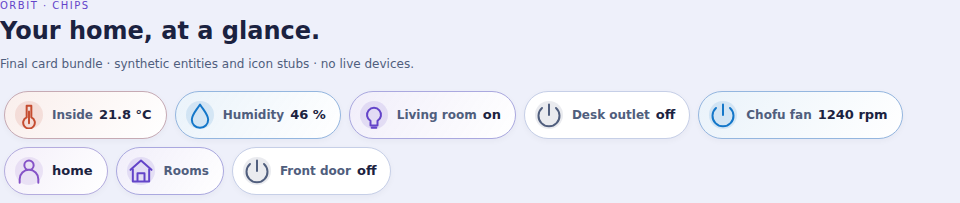
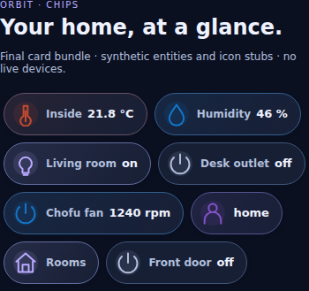

# Chips Orbit Card

First-party **Orbit Chips1.0.0**, included in **Orbit Lovelace1.18.0+** as `custom:ha-chips-orbit-card`. The same single HACS Dashboard resource; no separate repository, dependency, theme YAML update or backend integration.

## Design and install

Update Orbit Lovelace in HACS, fully reload each browser/Companion frontend, then choose **Chips Orbit Card** in Add card. Add/reorder/remove chips in the visual editor and choose your actual entities. The empty picker stub selects nothing automatically.

Capsule-style chips have a local accent, icon, optional name and reported state. They wrap naturally instead of hiding chips offscreen. Collection alignment can be start/center/end. The collection has **no large outer card frame**. Each interactive chip keeps a minimum44px hit area. Normal uses48px pills; Compact keeps44px pills with smaller labels/icons and gaps. Unlike a single-entity card, a collection **does not collapse into an aggregate tile or Details arrow**: every configured chip remains visible. Long labels/readings wrap safely rather than clipping units. No layout installs or changes dashboard routes.

Default Aurora follows Orbit themes, including Prism. Explicit Ocean/Sunset/Lavender keep their local palette. Sensor chips use the accent; on/off entities color only reported ON, with neutral OFF/unknown/unavailable/offline states. Common hazardous binary device classes (smoke, gas, carbon monoxide, moisture, problem and safety) use the semantic error color when ON, not a decorative palette. Actual sensor values/units and light RGB metadata are never changed or converted. This is a generic entity chip, not a device-specific alarm panel or a replacement for native controls.

## Examples

Replace example entities and navigation paths with your own. The Chofu RPM entity below was supplied by the owner; there is no guessed maximum or percentage.

```yaml
type: custom:ha-chips-orbit-card
alignment: start
chips:
  - entity: sensor.pompa_caldura_chofu_ventilator_rpm
    name: Chofu fan
    icon: mdi:fan
    palette: ocean
  - entity: sensor.example_room_temperature
    name: Inside
    palette: sunset
  - entity: light.example_living_room
    name: Living room
    tap_action:
      action: toggle
  - name: Rooms
    icon: mdi:home
    tap_action:
      action: navigate
      navigation_path: /dashboard-example/rooms
```

Each default entity chip opens native **More Info**. Use one chip by itself or a collection of up to24. There is no invented sensor discovery, hidden entity selection or templating.

Icon-only chip (the accessible name still includes the actual entity name/state):

```yaml
type: custom:ha-chips-orbit-card
layout: compact
chips:
  - entity: light.example_living_room
    name: Living room lights
    show_name: false
    show_state: false
    tap_action:
      action: toggle
```

## Schema

Collection keys:

- `chips`: array, default empty, at most24 entries.
- `title`: optional collection heading, absent by default.
- `palette`: aurora (default), ocean, sunset, lavender; inherited when a chip has no explicit palette.
- `alignment`: start (default), center, end.
- `read_only`: false by default; disables explicit power commands, not More Info or local navigation. It is a UI guard, not an HA permission boundary.
- `layout`: normal (default) or compact, using the suite selector.

Per-chip keys:

- `entity`: any valid entity ID; optional for local-navigation or decorative chips.
- `name`, `icon`: optional overrides; otherwise entity metadata/default icon.
- `palette`: optional local override from the same four palettes.
- `show_name`, `show_state`: true by default. Native HA formatted display is preferred when available; otherwise the raw reported state and unit are preserved. No implicit unit conversion.
- `tap_action`: a restricted action object, **not an arbitrary HA service/action executor**:
  - `{action: more-info}` (default): existing entity opens native details, even unknown/unavailable.
  - `{action: toggle}`: **light, switch and input_boolean only**, and only a reported on/off state. Sends the matching domain's explicit turn_on or turn_off service for that single entity.
  - `{action: navigate, navigation_path: /local/path}`: local absolute route only; no URLs, protocol-relative paths, backslashes or control characters. Normal click uses the HA location-changed contract; modified/new-tab clicks retain the real internal anchor.
  - `{action: none}`: non-interactive display chip, not a misleading button.

Toggle on fans, locks, covers, alarms, scenes, scripts, buttons and arbitrary domains is deliberately not supported. Such entities can use More Info. No hold/double-tap service, arbitrary service_data, templates, external URLs, history, weather subscriptions or polling. Invalid actions/routes/configurations are rejected rather than silently executed.

## Truthful power feedback

Commands require a connected frontend, an existing known on/off entity, a matching advertised service and read_only=false. One power request at a time per collection; immediate **Sending…**, then **Command sent**, generic failure, or **Result unknown** after15s. No automatic retries and no optimistic reported-state or color update. Service acknowledgment is not hardware confirmation. An acknowledged same-state intent is guarded until HA reports a state change, including duplicate chips for the same entity. Check the actual state before explicit retry after error/unknown result.

Ordinary hass updates preserve the chip DOM, keyboard focus and native controls. Changing the collection's actual config or removing it clears pending timers/tracking; stale promises cannot update a new configuration. A command already sent cannot be cancelled by removing a card. Offline chips label their last reported reading as Offline. Read-only or unsupported power conditions disable that power button; choose More Info as its action, or add a separate More Info chip, for native device controls.

The editor uses native `ha-form` entity/icon/select/boolean selectors with add/remove/up/down rows. The suite layout wrapper preserves layout in emitted config-changed events. Selecting, reordering and configuring chips sends no device command or API query.

## Previews and verification limits

Final suite bundle, mocked entities and local icon/form stubs, not a live HA capture:



[Compact phone](images/chips-dark-compact-phone.png).

Dedicated unit and final-bundle browser tests cover configuration, exact service payloads, pending/timeout/late-result cleanup, reported states, safe routes/text, keyboard/touch, persistent DOM, editor schema/events/add/remove/reorder, themes and Normal/Compact phone widths. Current counts and compatibility proofs are in `chips-verification.json`. Native HA visual editor/route rendering, physical Companion/Safari and actual device outcomes remain unverified. No live HA configuration, resources, theme, dashboard or device was changed.

## Rollback

Remove/replace Chips instances before reverting to a suite older than1.18.0. Existing card YAML, palettes, theme definitions and single resource URL are otherwise unchanged.

## Contract sources

The existing suite native editor/command contracts and HA Core2026.10.4 service registries were inspected. Native ha-form data/schema/hass/value-changed and config-changed wiring follows [HA frontend Button editor](https://github.com/home-assistant/frontend/blob/dev/src/panels/lovelace/editor/config-elements/hui-button-card-editor.ts). HA's internal history/location-changed contract is retained for local links; do not confuse a synthetic route-event assertion with validation of a user's actual dashboard routes.
