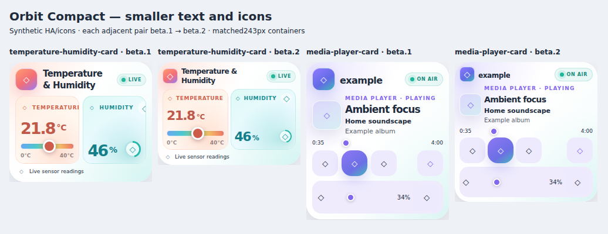
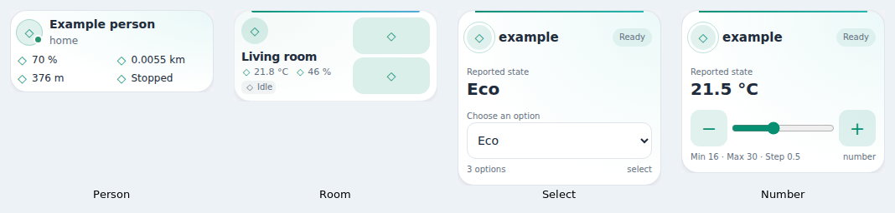

# Selectable Compact layouts — v1.12.0-beta.2

**Test prerelease, not the stable update.** All30 primary card types have a user-selected **Card layout → Normal / Compact**. Same Orbit resource/types/themes; no extra installation or automatic mobile activation. Native editor/device testing on real HA/Companion remains pending.

## Smaller text and icons in beta.2

The Compact option now also reduces typography and glyphs, not only spacing: most card headings are12–13px; primary readings use individual14–22px profiles; common decorative/header glyphs are14–16px in24–26px wrappers. Welcome retains an18px greeting, Person keeps complete11px paired readings and smaller existing metric icons; already-small metadata is not blindly scaled. Media artwork/track text, printer SVGs, Gate/Washer symbols and Number ± glyphs are handled explicitly. Media/native-control44px buttons and input interaction contracts are retained; a smaller glyph is not a smaller command target. This is not a universal44px/WCAG claim for all inherited controls.

Measured against beta.1 at164/243/440px:90 matched compact samples have smaller text and glyphs, smaller decorative diameters where present, and no summary height growth.90 corresponding Normal snapshots are unchanged; the full30-card normal baseline still matches stable1.11.0. [Density measurements](compact-density-measurements.json). All data/services remain unchanged; no global zoom/transform scaling or theme YAML changes. Existing Compact cards adopt the new density after updating/reloading; no extra YAML option.



## Install the beta in HACS

1. Save a copy of the card/dashboard YAML and note the installed suite version.
2. Open **HACS → Orbit Lovelace → ⋮ → Redownload**. Under **Need a different version?**, choose **v1.12.0-beta.2**. If not listed, refresh repository metadata and enable prereleases/beta visibility for this repository in your HACS version. It is intentionally not the stable/latest release.
3. Download, then fully reload each browser and Companion frontend. No HA restart or theme YAML replacement is needed.
4. Edit a card and select **Card layout → Compact**. Legacy editors retain their original controls below the common layout selector. The new Vacuum native form exposes common settings; existing room mappings stay in YAML.
5. Start with a copied card or test view. Report the card type, actual dashboard/container width, YAML without private data, and screenshot if any layout is wrong. No real device command is necessary to inspect the layout.

The only resource remains `/hacsfiles/orbit-lovelace/orbit-lovelace.js`; do not add another resource or standalone card alongside it.

[HACS specific-version instructions](https://www.hacs.xyz/docs/use/repositories/dashboard/#downloading-a-specific-version-of-a-repository) · [HACS prerelease switch behavior](https://www.hacs.xyz/docs/use/entities/switch/)

## Configuration

```yaml
type: custom:ha-number-orbit-card
entity: number.example_target
layout: compact
```

Use the same `layout: compact` key for every included primary type. `layout: normal` selects the normal appearance; omitting it preserves the previous configuration behavior. Welcome also retains its existing `layout: classic` alias for Normal. Person compact uses the previously verified paired reading layout; returning to Normal respects your existing `metrics_layout` setting, without rewriting it. The legacy `living-temperature-card` alias inherits the Temperature/Humidity presentation.

No other key changes: forecast layout/count/type, Number slider/box mode, precision/unit settings, selected entities, read-only, palette, navigation, room mappings and supported services remain independent. Do not replace your existing YAML with the minimal example above.

## What ships in this beta

- Individual compact CSS profiles for30 types, not one universal scaling rule. Reduced whitespace/decoration, reorganized telemetry, smaller illustration/chart areas and container-width refinements. Reported numeric values keep the original card formatting; compact adds no rounding or unit conversion.
- **Fan:** primary power/speed stays visible; presets/direction/oscillation expand under Show details.
- **Gate and Washer:** large illustration is behind Show details; actual state/progress/controls stay visible.
- **UniFi Orbit / Command Center:** status/telemetry stays visible; topology and, for Command Center, roster are available in Show details. Other selected-device detail/action behavior is retained.
- **Welcome:** reuses its existing compact shortcut disclosure. **Room, Climate, Luma and Media** retain their existing distinct details/adjustment mechanisms.
- Other configured values/lists remain inline in a tighter layout for this first beta. In particular, Weather forecast and NAS drive telemetry are not silently hidden. The broader [design reference](COMPACT-DESIGN.md) is not a claim that every proposed secondary panel has been collapsed already.
- Key controls/disclosure targets are kept or enlarged; small informational hit areas inherited from some upstream cards are not a blanket44px/WCAG certification. Very narrow complex cards may need additional rows rather than tiny controls.
- Layout-only switches reuse controls/subscriptions when their effective source configuration is unchanged, preserving drafts/pending interactions. Person/Welcome changes that alter their original render configuration use their original lifecycle. Configuration changes still do not cancel already-sent services.

Compact removes inherited fixed row hints where the card supplies them. Existing explicit dashboard `grid_options`/fixed parent rows can still reserve space; use Auto sizing in the dashboard if necessary. Do not edit a live dashboard automatically to repair a parent constraint.

## Previews and measured examples

Actual distributed bundle with synthetic HA entities/icons, **not native HA screenshots**.



[Per-card243/440px measurements](compact-measurements.json) compare identical populated configurations in the browser. All30 were measurably smaller at both measured widths. These are fixture-specific results, not a universal height/percentage guarantee for arbitrary names, lists and device capabilities. Half-phone cards are separately tested in actual two-column grids.

## Verification

-592 Node tests (174 suite/theme/native/compact +418 unchanged upstream),2 smoke suites, syntax and deterministic build. Upstream27 package pins, native Controls1.0.0 source and Themes1.1.0 definitions/contracts unchanged; suiteFeatures explicitly hashes the new adapter/profiles.
-30 editor selectors,60 populated Normal/Compact geometry comparisons at243/440px,1440 sequential populated theme/layout mounts (30×2×24 modes),90 actual two-card phone grids at360/390/430px. Complete selected value bounds, exact Person paired geometry, disclosure keyboard/state retention, observer cleanup/reconnect, legacy editor config events and fallback without constructable stylesheets checked. Forecast bars and chart histories use populated fixtures, not only loading placeholders.
- All30 populated omitted-layout cards match released1.11.0 computed geometry/fonts/colors/padding/display and grid/size hints in a deterministic baseline browser comparison.
- Final-bundle Select/Number regressions exercised with compact forced in the test configuration, including actual dropdown/keyboard, drafts/Apply/Escape, exact decimals, slider mouse/touch release/cancellation, stale metadata, errors/timeouts and More Info. Media mobile Chromium touch/gesture/command feedback/browse-media regression likewise exercised in Compact. Explicit compact touch dispatch tested for Fan/Switch/Gate/Climate/Luma, Scenes confirmation and weather More Info. All service calls mocked.
- Existing suite registration/alias/duplicate/standalone-first and real card-mod mobile-profile regressions retained. No live HA installation/config/dashboard/theme/entity/device operation performed. Physical phone/native Companion/Safari/native HA editor remain unverified.

## Return to stable

Select Normal (or remove the new layout key), save your configuration, then HACS Redownload → **v1.11.0** and fully reload. Before downgrading, remove newly added `layout` keys on cards other than Welcome or restore your saved YAML. Welcome1.11.0 accepts only its existing classic/compact values, not the new normal alias. Original Person `metrics_layout` remains valid. Keep the same single resource; no theme or entity rollback is needed.
