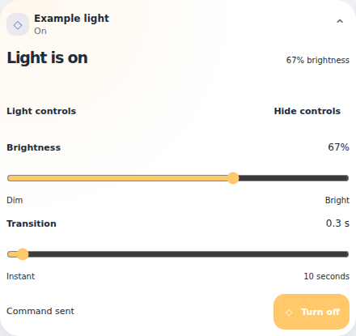
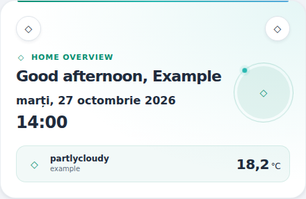
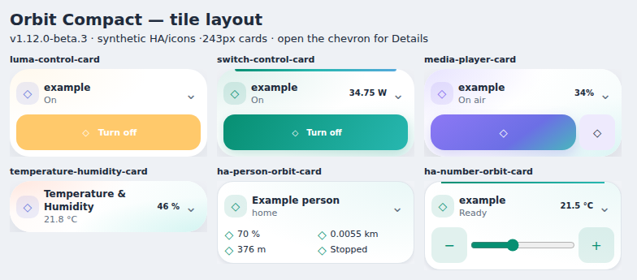

# Selectable Compact layouts — v1.12.1

**Stable release.** v1.12.0 promoted the approved beta.5; v1.12.1 narrowly fixes the Luma Compact header duplication described below. All30 primary card types retain **Card layout → Normal / Compact**, the same resource/types/themes and opt-in behavior. Automated verification remains synthetic, not universal native editor/device certification.

## Compact Light/switch identity fix (v1.12.1)

The Luma Control Card profile keeps the original source header hidden in both closed and expanded Compact, preventing a second name/icon/state row under the persistent tile. Hidden source text/icons still drive the reported summary; no native control is deleted, cloned or rebound. The header is no longer a Details target, so off, unavailable, power-only and switch configurations with no secondary controls do not have an empty disclosure arrow. Available advanced light controls remain in Details, with original power/brightness commands and feedback. Normal and the other29 profiles are unchanged; this is not a claim that every card's source header has been redesigned.



## Welcome Normal date/time emphasis (beta.5)

Welcome Normal now uses a24px/750-weight clock and16px/600-weight date, with primary theme text color and separate rows. This applies to explicit Normal/classic and the existing Normal toolbar mode (omitted layout with settings_path). The full localized date may wrap on narrow cards; it is not truncated or abbreviated. Original locale/time zone, clock refresh, show_date/show_time and navigation behavior remain unchanged. Compact and legacy omitted-without-settings appearance stay unchanged. No new option or YAML change is required.



## Welcome Normal toolbar correction (beta.4)

Welcome **Normal** (including the editor’s saved `layout: classic` alias) now shows the native room disclosure and configured Settings link, keeping its full classic header, decoration and weather. Existing paths/labels/scenes are preserved; all configured shortcuts (up to8) remain in the expandable row. `shortcuts_expanded` controls its initial state. Settings appears only with a nonempty valid `settings_path`; no route is guessed. The arrow appears only when shortcuts exist. Omitted layout with an existing settings_path also gains this toolbar; omitted layout without settings_path keeps its original appearance.

No YAML change is required for affected Normal cards. This intentionally corrects the earlier unchanged-Normal claim: beta.3 mapped Normal to classic, whose upstream implementation did not render these controls. Original navigation, modifier-key handling, local-path validation, read-only scenes and native events remain in use. Compact tiles and all other card layouts are unchanged.

## Compact now means a tile, not a scaled full card

Beta.3 changes the structure: a small icon, name, reported state and a selected reading, plus only the usual command row where appropriate. The chevron opens **Details** in the same card. Graphs, forecasts, illustrations, long lists and secondary controls remain available there. Existing Compact configurations adopt this layout after update/reload; no new YAML key is required.

Names/values are text, not injected HTML; configured source icons and Person pictures are retained. Tile headings are12px, states11px and the main icon18px in a28px wrapper. Below210px, the selected reading moves into the state line to avoid squeezing the title. Values preserve source precision/units; whitespace is normalized without rounding. Native command targets and guards remain; this is not a blanket44px/WCAG claim for all inherited controls.



## Install or update in HACS

1. Save a copy of the card/dashboard YAML and note the installed suite version.
2. Open **HACS → Orbit Lovelace** and update to **v1.12.1**, the latest stable release. If changing from a beta or the update is not listed yet, refresh repository metadata or use **⋮ → Redownload → Need a different version? → v1.12.1**. Prerelease visibility is not required for this stable release.
3. Download, then fully reload each browser and Companion frontend. No HA restart or theme YAML replacement is needed.
4. Edit a card and select **Card layout → Compact**. Legacy editors retain their original controls below the common layout selector. The new Vacuum native form exposes common settings; existing room mappings stay in YAML.
5. Existing beta.5 layouts and settings work unchanged; there is no automatic switch into Compact. When first trying Compact, use a copied card or test view. Report the card type, actual dashboard/container width, YAML without private data, and screenshot if any layout is wrong. No real device command is necessary to inspect the layout.

The only resource remains `/hacsfiles/orbit-lovelace/orbit-lovelace.js`; do not add another resource or standalone card alongside it.

[HACS specific-version instructions](https://www.hacs.xyz/docs/use/repositories/dashboard/#downloading-a-specific-version-of-a-repository) · [HACS prerelease switch behavior](https://www.hacs.xyz/docs/use/entities/switch/)

## Configuration

```yaml
type: custom:ha-number-orbit-card
entity: number.example_target
layout: compact
```

Use the same `layout: compact` key for every included primary type. `layout: normal` selects the normal appearance; omitting it preserves the previous configuration behavior. Welcome also retains its existing `layout: classic` alias for Normal. Person compact uses the previously verified paired reading layout; returning to Normal respects your existing `metrics_layout` setting, without rewriting it. The legacy `living-temperature-card` alias inherits the Temperature/Humidity presentation.

No other key changes: forecast layout/count/type, Number slider/box mode, precision/unit settings, selected entities, read-only, palette, navigation, room mappings and supported services remain independent. Do not replace your existing YAML with the minimal example above.

## What ships in this beta

- **All30 primary types:** tile summary and keyboard-operable Details chevron; expanded content uses the original elements/listeners, not cloned device controls. Other Normal cards remain unchanged; Welcome Normal gains its toolbar as documented above. Opening Details itself sends no services or new queries; existing subscriptions/data requests continue normally while closed.
- **Light/Switch/Fan/Dehumidifier/Climate:** native power command stays in the tile; speed/presets/targets/modes/measurements and other settings move into Details. Existing native Adjust controls panels remain inside Details where applicable.
- **Media:** native play/pause and mute stay visible when supported; off players retain the guarded Turn on button. Artwork, seek, volume slider, previous/next/power and advanced browsing/source controls are in Details, with the source's own More/browse mechanisms retained. Pending/sent/error/unknown feedback is not replaced by optimistic device state.
- **Gate:** all three guarded Open/Close/Stop commands stay visible for safety; state/position are in the tile, illustration and supporting telemetry in Details. **Vacuum:** native main controls stay; room maps/quick-clean and additional information are in Details.
- **Room:** the first two configured native shortcut buttons stay visible; other shortcuts and detailed tiles are behind Details. A configured local navigation_path is also available from the tile title through the original guarded navigation handler. **Person:** paired compact readings stay visible, with native More Info available in Details.
- **Select/Number:** the reported value is in the tile; the actual dropdown/slider/± or explicit-Apply box stays below it. Drafts, range validation, read-only, cancellation, exact decimals and service feedback remain original. Box mode may need extra rows rather than hiding Apply or shrinking command targets.
- **Scenes:** first configured action remains visible with its original confirmation/More Info; remaining entries are in Details. **Action button:** its original action, confirmation and feedback stay visible.
- **Alerts/Battery, NAS/Server/Speedtest, both UniFi views, Weather/Welcome, Frigate, Washer/Printer, Pi-hole, Sensor Meter and Temperature/Humidity:** short title/state/selected reading; their rows, charts, forecast, camera preview, illustrations, statistics and secondary controls are in Details. Welcome's existing shortcut toggle/weather/settings/navigation remains available inside Details. Detailed selected-device and native panel mechanisms are retained.
- Errors/warnings inside hidden source content are mirrored as plain text in the summary; feedback already visible is not duplicated. Long names/messages can increase the tile height rather than being silently clipped.
- Layout-only switches preserve source controls/subscriptions when effective source configuration is unchanged. Real configuration changes retain original validation/lifecycle. No sent command is cancelled or retried automatically by the tile adapter.

Compact removes inherited fixed row hints where the card supplies them. Existing explicit dashboard `grid_options`/fixed parent rows can still reserve space; use Auto sizing in the dashboard if necessary. Do not edit a live dashboard automatically to repair a parent constraint.

## Previews and measured examples

Actual distributed bundle with synthetic HA entities/icons, **not native HA screenshots**.


[Per-card243/440px Normal/tile measurements](compact-measurements.json) compare identical populated configurations in the browser. All30 were measurably smaller at both measured widths. These are fixture-specific results, not a universal height/percentage guarantee for arbitrary names, lists and device capabilities. Half-phone cards are separately tested in actual two-column grids.

## Verification

-90 closed/expanded tile samples at164/243/440px: title/state, readable bounds, keyboard Details, original control identity, no service/query from disclosure, hostile text escaping, source icon attribute updates, hidden warning mirroring and primary Room local navigation. Closed Media playback/mute/power and native Select/Number exact commands verified separately from expanded regressions. [Tile measurements](compact-tile-measurements.json). Fixture height budgets are tests, not a universal maximum.

-593 Node tests (175 suite/theme/native/compact +418 unchanged upstream),2 smoke suites, syntax and deterministic build. Upstream27 package pins, native Controls1.0.0 source and Themes1.1.0 definitions/contracts unchanged; suiteFeatures explicitly hashes the adapter/profiles and Welcome build adaptation.
-30 editor selectors,60 populated Normal/Compact geometry comparisons at243/440px,1440 sequential populated theme/layout mounts (30×2×24 modes),90 actual two-card phone grids at360/390/430px. Complete selected value bounds, exact Person paired geometry, disclosure keyboard/state retention, observer cleanup/reconnect, legacy editor config events and fallback without constructable stylesheets checked. Forecast bars and chart histories use populated fixtures, not only loading placeholders.
- All30 populated omitted-layout cards match released1.11.0 computed geometry/fonts/colors/padding/display and grid/size hints in a deterministic baseline browser comparison.
- Final-bundle Select/Number regressions exercised with compact and Details expanded in the test configuration, including actual dropdown/keyboard, drafts/Apply/Escape, exact decimals, slider mouse/touch release/cancellation, stale metadata, errors/timeouts and More Info. Media mobile Chromium touch/gesture/command feedback/browse-media regression likewise exercised in Compact with Details expanded; closed primary controls are covered separately. Explicit compact touch dispatch tested for Fan/Switch/Gate/Climate/Luma, Scenes confirmation and weather More Info. All service calls mocked.
- Existing suite registration/alias/duplicate/standalone-first and real card-mod mobile-profile regressions retained. No live HA installation/config/dashboard/theme/entity/device operation performed. Physical phone/native Companion/Safari/native HA editor remain unverified.

## Rollback

For the previous denser-but-full presentation, HACS Redownload **v1.12.0-beta.2** and fully reload; same YAML.

### Return to the previous stable v1.11.0

Select Normal (or remove the new layout key), save your configuration, then HACS Redownload → **v1.11.0** and fully reload. Before downgrading, remove newly added `layout` keys on cards other than Welcome or restore your saved YAML. Welcome1.11.0 accepts only its existing classic/compact values, not the new normal alias. Original Person `metrics_layout` remains valid. Keep the same single resource; no theme or entity rollback is needed.
