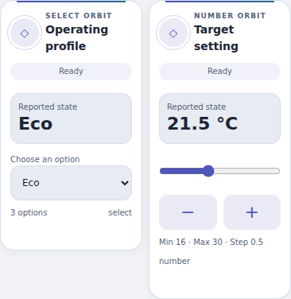
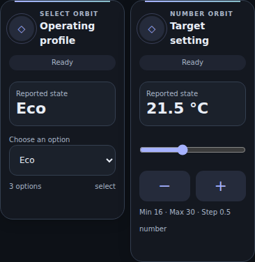

# Select Orbit and Number Orbit

First-party **Orbit Controls1.0.0**, included in Orbit Lovelace **1.11.0+**. Two native cards in the existing single resource; no new repository, standalone HACS installation, dependency or backend integration. Home Assistant2026.6+ for the native visual configuration form.

## Install and choose entities

Update **Orbit Lovelace** in HACS, fully reload each browser/Companion frontend, then select **Select Orbit Card** or **Number Orbit Card** in Add card. Pick your own entity in the visual editor. Empty configuration shows a setup hint and chooses nothing automatically. Keep the single `/hacsfiles/orbit-lovelace/orbit-lovelace.js` module; do not add `src/` files as resources. Existing cards/configurations are unchanged. No theme YAML update is needed.

```yaml
type: custom:ha-select-orbit-card
entity: select.example_operating_profile
name: Operating profile
palette: aurora
```

Also supports `input_select.*` with its own domain service. The dropdown contains only the current entity `attributes.options` strings, in reported order (duplicates removed, no invented options). Values are sent exactly, without translation/case folding. The reported current state is displayed separately; an unknown state or a state not in the options does not silently select the first entry. Existing unknown/unavailable entities can still open native More Info.

```yaml
type: custom:ha-number-orbit-card
entity: number.example_target
name: Target setting
control: auto
palette: aurora
```

Also supports `input_number.*`. Requires finite numeric `min`/`max`/positive `step` attributes and a numeric, in-range reported state; nothing is guessed from missing metadata. Unit is taken from `unit_of_measurement`, without conversion.

- **Slider:** keyboard or pointer/touch release commits once. `input` events only preview a draft; cancelling the gesture sends nothing. Buttons ± use the next/previous valid step-grid value from the HA-reported value.
- **Box:** typing creates a marked **Draft (not sent)**. Commit with **Apply value** or Enter. Blur alone does not send; Escape discards the draft.
- **Auto:** uses Box when the entity reports `mode: box`, otherwise Slider. An explicit `control: slider` or `box` changes only the UI, not limits/step/unit.
- Typed off-grid or out-of-range values are rejected, not silently snapped/clamped. Grid is anchored at the reported minimum; if maximum is not step-aligned, the last selectable grid value may be below maximum. A reported off-grid state can move to its adjacent valid grid point with ±. Exact decimal grid arithmetic prevents `0.2 + 0.1` becoming an invalid long floating value. No display rounding of the raw state/unit; impossible representable step targets are disabled instead of guessed.

## Options (native editor and YAML)

| Key | Default | Meaning |
| --- | --- | --- |
| `entity` | empty | Select/input_select or Number/input_number, depending on card |
| `name` | empty | Name override; otherwise friendly name |
| `icon` | empty | Icon override; otherwise entity icon or card icon |
| `palette` | aurora | aurora, ocean, sunset, lavender |
| `read_only` | false | Disable commands, preserve native More Info |
| `control` | auto | Number only: auto, slider, box |

All fields are optional. Cleared fields return to defaults. Labels/icons do not infer an entity. The default Aurora palette accepts Orbit theme accents/surfaces; explicit alternate palettes retain their identity. Both light/dark and Desktop/Mobile/iOS Mobile color tokens work. No new theme definitions or card-mod dependency is needed for these controls; existing mobile-header themes still have their separately documented dependency. No generic service/YAML action execution, route/GPS queries, history or automatic discovery.

## Command safety and truthful feedback

Controls require a known existing state, a connected frontend, the matching advertised HA service and read_only=false. Missing/unknown/unavailable/offline/missing-service/invalid-range/empty-options conditions disable commands; only missing entities disable More Info. Read-only is a UI guard, not an HA security boundary; actual permissions are enforced by HA.

Select sends only `<select|input_select>.select_option` with the chosen entity ID and raw option. Number sends only `<number|input_number>.set_value` with the chosen entity ID and a numeric value. Options/range/step/availability/service are rechecked at dispatch, including changes made while a control is focused.

One request at a time per card, immediate **Sending…**, then **Command sent** or a generic clear failure message. A15-second timeout says **Result unknown** and does not retry. A service acknowledgment does not mean hardware reached the requested state; the main readout always comes from HA, never optimistic state. Identical acknowledged requests are guarded until a relevant reported-state/options/range update, preventing repeat writes while HA is catching up. Check the actual state before an explicit retry after an error/unknown result.

Ordinary HA state updates do not replace the controls, and focused drafts/options remain stable. Removed options are validated again on commit. Number drafts whose range, step, mode or unit changed while editing are rejected and must be reviewed, even when their raw value would still fit the new limits. Configuration changes/removal clear timers and ignore stale promise results; an already-sent service cannot be cancelled by removing a card. Reconnecting may show a request is no longer tracked; inspect reported state rather than assuming cancellation/success.

## Verification and limits

74 dedicated Node regressions cover both helper and integration domains, optional editor/schema, exact payloads, decimals/boundaries/step grids, zero/negative values, invalid metadata, offline/read-only/stale options/limits, errors, one-request guard, timeout/late results and removal. Browser tests from the final suite cover actual native dropdown/keyboard, input draft/Apply/Escape, slider mouse/touch release/cancellation, stable controls, hostile metadata escaping, More Info and complete layouts at164/200/243/440px plus two cards side by side on360/390/430px viewports, light/dark. Full suite registration/theme regressions retained.

Tests use synthetic hass/native HA component/icon stubs and mocked services, not live entities. Native HA visual editor, physical iOS/Android Companion, actual integrations and device outcomes remain unverified. No live HA configuration/dashboard/resource/entity/device has been modified.

## Design previews

Actual final card bundle, synthetic HA/data and **stub icons**; not a native HA screenshot.





## Service contract sources

Inspected HA Core2026.10.4: [select](https://github.com/home-assistant/core/blob/2026.10.4/homeassistant/components/select/services.yaml), [input_select](https://github.com/home-assistant/core/blob/2026.10.4/homeassistant/components/input_select/services.yaml), [number](https://github.com/home-assistant/core/blob/2026.10.4/homeassistant/components/number/services.yaml), [input_number](https://github.com/home-assistant/core/blob/2026.10.4/homeassistant/components/input_number/services.yaml), and Number capability attributes. Native suite source is `src/orbit-controls.js`, version/hash in `components.json` → `nativeComponents`; provenance is the Orbit release commit/tag, not a fictional standalone upstream repository. Root MIT LICENSE applies.
