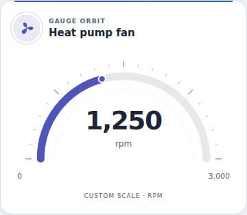
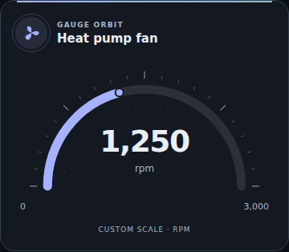
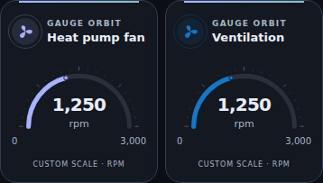
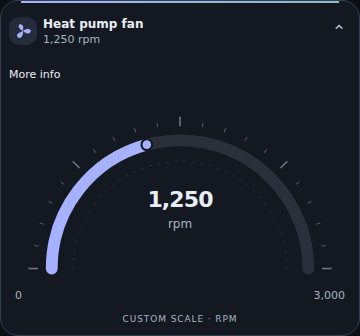

# Gauge Orbit Card

Added in Orbit Lovelace **v1.16.0**. A first-party, read-only semicircular gauge for a numeric `sensor.*`: RPM, pressure, power, temperature or another reported numeric quantity. An RPM sensor remains a sensor, not a controllable `fan.*`. No device commands, history requests, external dependencies or background timers.

## Install in the existing suite

Update **Orbit Lovelace v1.16.0** in HACS, then fully reload your browser/Companion frontend. Add **Gauge Orbit Card** from the picker and choose a numeric sensor. Same single `/hacsfiles/orbit-lovelace/orbit-lovelace.js` resource; do not add a standalone repository/resource. No theme YAML update or HA restart is needed. No live dashboard or equipment is changed by publication.

## Design

Normal shows Orbit's accent stripe, circular icon and name, a semicircular arc with fine tick marks, an endpoint indicator and a large centered reading. The unit stays beneath the actual value. Scale endpoints and their source remain explicit; palette colors decorate the gauge, not an invented safe/danger zone. The indicator and arc update together without a misleading intermediate sweep. Very long readings/units move below the arc instead of being clipped.

Compact follows the suite tile pattern: one primary identity and reported reading, with the gauge, scale and native More Info in keyboard-accessible Details. Missing-scale hints, out-of-scale and availability states stay visible in the tile. Normal/Compact preserve the original DOM controls and reported value.






These are synthetic browser previews. Their **0–3000 rpm** scale is demonstration data, not a specification for your fan or heat pump.

## Choose an honest scale

Set `min` and `max` in the visual editor/YAML using a meaningful range in the entity's reported unit. If omitted, each bound can come from the entity's numeric `min`/`max` attributes. Both bounds must be finite, the upper must exceed the lower, and the width must remain finite. An explicit configuration value overrides the corresponding entity attribute.

The card never guesses a maximum from RPM, the current reading, the sensor name, an observed peak or a hard-coded percentage range. A sensor without complete valid limits still shows the real value and a neutral unscaled arc, with **Set scale minimum and maximum in the editor**. There is no fabricated fill, marker, tick scale or percentage.

```yaml
type: custom:ha-gauge-orbit-card
entity: sensor.fan_rpm
name: Heat pump fan
icon: mdi:fan
palette: aurora
decimals: 0
```

This is deliberately unscaled unless the entity supplies bounds. Once you know the display range, enter the two numeric limits in the editor. For a **synthetic demonstration only**, the following adds a 0–3000 scale:

```yaml
type: custom:ha-gauge-orbit-card
entity: sensor.fan_rpm
name: Heat pump fan
icon: mdi:fan
palette: ocean
min: 0
max: 3000  # EXAMPLE ONLY: replace with your actual intended scale
decimals: 0
layout: normal
```

Scale limits are display bounds, not automatically equipment-rated limits or alarm thresholds. For RPM, zero is a valid reported value, never assumed to mean the whole heat pump is off. No speed command or service is sent.

## Options

| Option | Default | Meaning |
| --- | --- | --- |
| `entity` | empty | A numeric `sensor.*`. Nothing is selected automatically. |
| `name` | entity friendly name | Optional name override. |
| `icon` | entity icon, then fan for `rpm`, otherwise gauge | Optional namespaced HA icon override. |
| `palette` | `aurora` | Aurora/Ocean/Sunset/Lavender. Aurora inherits the selected Orbit theme. |
| `min` / `max` | entity attributes, otherwise unset | Numeric display bounds in the current entity unit. |
| `decimals` | automatic | Integer 0–6. Automatic uses valid suggested precision, otherwise up to six decimals. |
| `layout` | `normal` | `normal` or `compact`, through the suite adapter/editor. |

All source options are exposed in the native visual form. Numeric limits must be numbers, not quoted strings. Clearing optional bounds/precision restores the automatic/unset behavior. Locale controls numeric separators; units come only from the entity, with no implicit conversion or invented unit.

## Truthful states and accessibility

- Below/above the scale, the arc is clamped only at its endpoints; the **actual reported value is not clipped**, and **Below scale / Above scale** is shown. This is not an alarm classification.
- Zero and negative decimal values are supported. Unknown, unavailable, missing entity and nonnumeric readings are distinct and never become a fake zero.
- A disconnected frontend retains its last reported value with an explicit label, while the active arc/marker becomes neutral.
- If an entity changes unit while manual limits are active, the card neutralizes the scale and asks you to edit the card/check limits. It does not reuse RPM limits silently as Hz. Re-saving the card acknowledges the current unit. An entity-owned scale can follow changed unit/bound metadata without conversion. A frontend reload establishes the initial unit again; YAML does not persist a separate unit contract.
- Text and units use safe DOM text updates. SVG contains only validated numerical geometry. No arbitrary HTML, actions, URLs or service configuration.
- Header button opens native HA More Info for the exact selected entity; it supports keyboard focus/Enter/Space. In Compact, open Details to reach its relabeled More info button. The SVG has a readable value/scale/status description. Reduced-motion settings are respected.
- No history polling, timers, sockets or side-effectful lifecycle work. Unrelated HA updates preserve the gauge/control nodes and send no requests.

## Provenance and rollback

`nativeComponents` records `orbit-gauge` v1.0.0, `src/orbit-gauge.js` and its exact SHA256. This is suite-owned code, not an invented upstream repository. The suite now has 32 primary card types from 27 pinned upstream packages and three native modules. All existing 31 cards, native Controls/Temperature, prior runtime adapters and Themes1.1.0 remain unchanged; only a new Compact profile is added.

Before reverting to v1.15.0, remove/replace Gauge Orbit instances, because that older release does not register the new type. Other existing card configurations do not need to change.

## Verification

Dedicated Node tests cover schema/validation, numeric precision, finite/clamped scales, missing or invalid metadata, negative/zero/extreme values, unit changes, native More Info and no side effects. Final-bundle Chromium verifies the actual delivered arc, marker, text, unknown/unscaled/out-of-range states, keyboard, responsive two-column phone layouts, all Orbit theme modes/palettes and Normal/Compact. Screenshots use mock HA state and an icon stub. Native HA editor, physical Companion/Safari and equipment are not certified by these tests. No live HA configuration, dashboard or fan/heat-pump command was changed.
