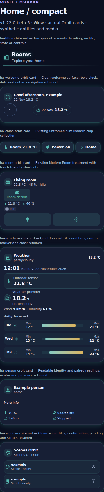
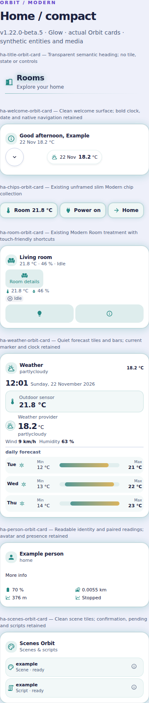
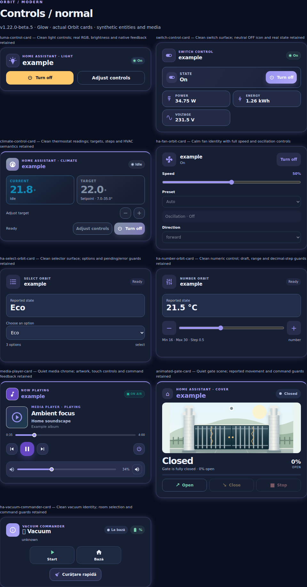

# Orbit Glow

An optional, static glow is available on **all 37 primary Orbit card types** in **v1.22.0**. It works independently of Classic/Modern and Normal/Compact. It is disabled by default: omitted `glow` and `glow: false` leave the decorative halo off.

## Enable

Update to **v1.22.0** in HACS → Orbit Lovelace, then fully reload the frontend/Companion app. Edit any Orbit card and enable **Glow**, or add:

```yaml
design: modern
palette: teal
glow: true
```

These are additional keys on an existing card; keep its `type`, entity IDs and other configuration. Classic also supports Glow. Disable the editor toggle, remove `glow`, or set `glow: false` to turn it off. No new resource, theme YAML, dependency or HA restart is required.


## Temperature-aware Room glow

From beta.7, a Room card with `glow: true` uses its existing `temperature_entity`. Below **22 °C** the halo is a stronger blue; at **22 °C** it changes to amber, becoming more orange as the reported temperature rises. The effect is static, works in Classic and Modern, and accepts °C, °F and K. An unavailable, missing or unsupported reading falls back to the existing palette glow. Other cards, palette accents, card layout and the Room temperature-animation option are unchanged.

## Appearance

- Ordinary cards receive a restrained outer halo, following the selected local palette: Aurora, Ocean, Sunset, Lavender, Slate, Indigo, Teal, Rose, Amber or Ice. Without an explicit supported palette, it inherits the theme accent.
- Colors blend with the theme's primary text color to adapt to light and dark modes. Glow is decorative, not a device-state indicator: it does not mean the entity is on, healthy or available.
- **Chips:** each existing capsule glows using its native local/semantic accent. Individual chip palette choices, neutral unavailable states and alarm warning/triggered colors remain authoritative. No outer collection frame is added.
- **Title:** a soft text/icon glow; the heading remains transparent and unframed.
- Light RGB, HVAC states, alarm indicators, gauge semantics and AMS material colors are not recolored. Luma's automatic decorative glow follows the theme accent rather than pretending to report the bulb's RGB.
- There is no pulse, hover movement or new animation. Native device/alarm animations retain their existing behavior. Glow adds no network requests, timers or service calls.

Compact still displays secondary content immediately, without a suite Details arrow. Existing native navigation/Adjust/Browse controls are not removed. Changing only Glow preserves existing player/control/chart nodes and does not restart media or request history.

## Preview

Actual final-bundle cards with synthetic entities/history/media and licensed test-only MDI glyphs. These are not native Home Assistant or physical iPhone screenshots.







## Verification and rollback

See [historical beta.5 verification](glow-verification.json). The 27 upstream pins, six native module sources, Compact 0.4.0, Palettes 0.2.0 and Themes 1.2.0 are unchanged. The suite-owned Modern adapter 0.4.0 carries the independent Glow option before card registration; original card implementations remain in place.

To revert the effect, disable Glow or remove the `glow` key. No live HA dashboard, resource, theme, integration or device was modified. Native HA editor, physical Companion/iPhone, Safari and hardware behavior remain unverified. Glow is not a camera codec/resolution fix or a fix for the previously reported physical-phone scroll symptom.
