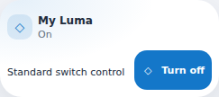

# Luma per-card appearance — Orbit v1.13.0

`custom:luma-control-card` now offers **Icon (optional)** and **Orbit palette** in the native visual form as well as YAML. Works for both light/switch entities and Normal/Compact. This addition is owned by the Orbit suite, not the unchanged standalone Luma1.2.1 input.

```yaml
type: custom:luma-control-card
entity: light.my_living_room
title: Living room
layout: compact
icon: mdi:ceiling-light
palette: ocean
```

Replace the example entity with your own. For a switch, use `entity: switch.my_switch`. Options apply independently per card, including multiple cards showing the same entity; entity metadata is never changed.

- `icon`: optional HA icon string. Priority: nonblank card override → entity `attributes.icon` → original state-aware light/switch default. Remove or clear the field to restore the original behavior. Does not replace the power button icon.
- `palette`: `auto` (default), `aurora` (green), `ocean` (blue), `sunset` (orange/red), or `lavender` (purple). Omitted/null/empty behaves like Auto. Use the singular key `palette`, not `pallete`. An unsupported nonempty value is rejected rather than injected into CSS.
- Auto retains the old theme/automatic colors. Explicit palettes color the decorative shell and identity icon in both layouts and the switch power accent. Light controls still reflect the existing real light color while on: changing a card palette never sends a color command or overwrites RGB/HS data. Semantic on/unavailable/error colors remain separate.
- Existing title, transition, capability checks, controls, command feedback, layout/Details and icon fallback remain. Without the two new keys, computed Normal and Compact output matches v1.12.2.

## Update and rollback

Update **Orbit Lovelace to v1.13.0 in HACS**, then fully reload browser/Companion frontend. No extra resource, theme YAML update or HA restart. No live configuration has been changed by this release. Select the palette and icon in each card editor or YAML. To restore previous styling, select Auto and clear Icon. Before downgrading to1.12.2, remove both new keys; older Luma ignores them. Do not add the standalone Luma resource alongside Orbit.



## Verification and provenance

Suite-owned1.0.0 build adaptation `scripts/luma-appearance.mjs` has exact replacement guards and a SHA256 under `components.json → suiteFeatures`. All27 imported input versions/commits/hashes remain unchanged, as do native Controls1.0.0, presentation0.3.4 and Themes1.1.0.

596 Node tests +2 smoke, syntax/deterministic build,192 final-resource appearance cases (2 layouts ×4 palettes ×2 domains ×4 states ×3 widths),192 explicit-palette theme cases (24 modes ×2 layouts ×4 palettes),24 Compact Luma regressions and general30-card/alias/migration browser checks pass sequentially. Configuration schema/reset/priority, attribute escaping, per-card independence, exact native power/brightness services, unavailable guards, visible errors and real RGB preservation covered. Both30-card default Normal and Compact computed snapshots match1.12.2. Light/dark previews inspected. Synthetic HA/icons only; native HA editor/physical Companion/hardware unverified.
