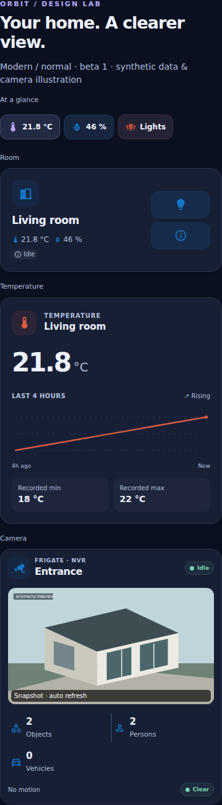
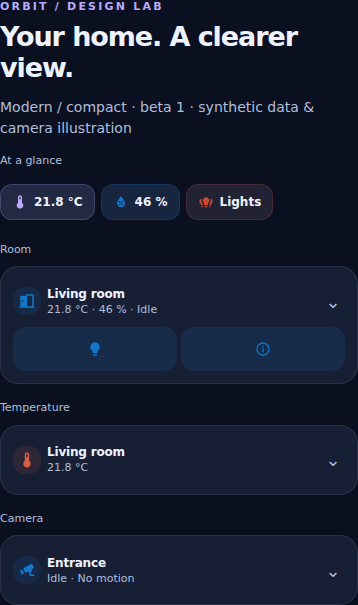
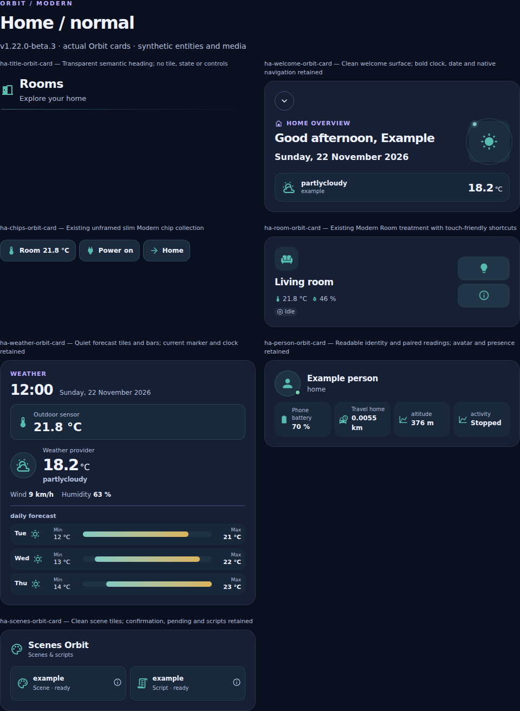
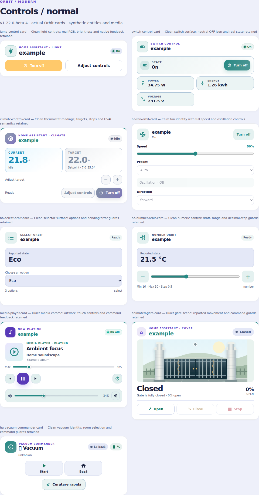
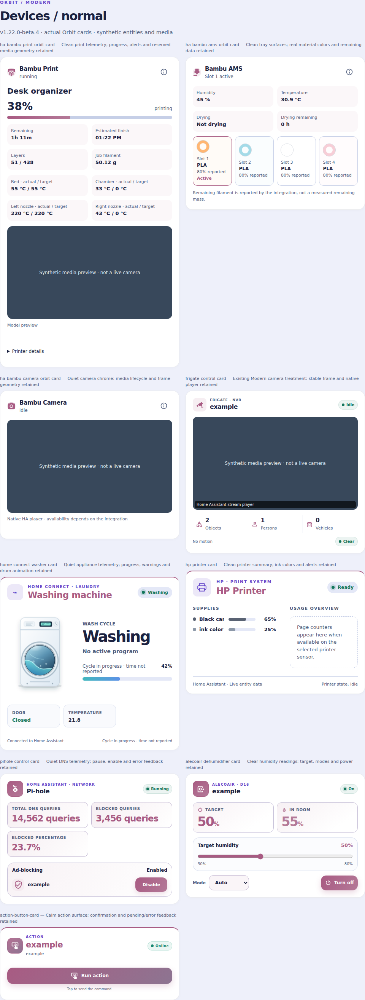
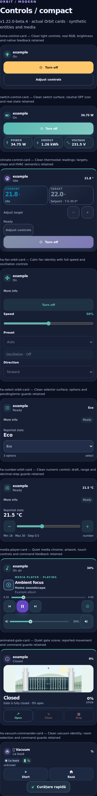

# Orbit Modern — Design Refresh

**Available in v1.22.0.** The suite provides optional suite-owned presentation for **all 37 primary card types**. Classic remains the default on every existing card. Beta.1 introduced the first four treatments; beta.2 extended the same visual system across the collection. Beta.5 adds independent, optional [Glow](GLOW.md) on every card, disabled by default.

## Visual direction

Clean surfaces instead of layered decorative gradients; quieter borders/shadows; 18px card corners; rounded-square icon surfaces; restrained typography with readable primary values. Existing local palettes and semantic warning/heating/cooling/alarm colors remain meaningful. No web fonts, extra runtime dependency, permanent animation or hover movement.

- **Room:** Beta.8 keeps shortcuts beside the room readings on two-column phones; only ultra-narrow cards stack them. The optional temperature-effect indicator is retained.
- **Chips:** slim rounded rectangles, subtle active-state tint, plain icons and existing name/state choices. The visible capsule remains 40px Normal / 36px Compact inside 48px / 44px touch targets. No outer card frame.
- **Temperature:** a calmer large reading, squared icon surface, lighter graph grid and neutral min/max containers. Recorded data, units, missing states and history requests are unchanged.
- **Frigate:** quieter header, a larger visual emphasis on the camera, thin separated detection readings and preserved status/errors. The frame stays 16:9; image/player/codec behavior is unchanged. This design does **not** fix H.265/MP4 compatibility or increase a camera's resolution.

Normal/Compact is independent of Classic/Modern. Beta.4 keeps compact typography and spacing, with all secondary content visible immediately and no suite Details chevron. Original Adjust/Browse/navigation controls retain their own semantics. Cards can be taller than the former collapsed tiles.

## Preview

These previews use **actual Orbit cards from the beta series**, with synthetic entities/history, licensed test-only MDI glyphs and a clearly labelled architectural camera illustration. They are not photos from a real camera, native HA screenshots or physical iPhone certification.

| Modern | Classic comparison |
| --- | --- |
|  |  |




## Install and try

1. Preserve a copy of your dashboard YAML. Update to **v1.22.0** in **HACS → Orbit Lovelace**, or select that version from **Redownload**.
2. Fully reload the frontend/Companion app so the new constructors replace cached ones. Keep the **same single Orbit resource**; do not add standalone resources.
3. Edit any Orbit card and select **Card design → Modern**. Keep Card layout Normal or Compact as preferred. For YAML, add `design: modern` to that card.
4. A small generic [demo dashboard](../examples/modern-dashboard.yaml) is provided. Replace example entity IDs and import into a **new empty dashboard**, never over your existing configuration. Importing is optional; existing cards can be edited individually.

```yaml
type: custom:ha-room-orbit-card
title: Living room
temperature_entity: sensor.living_room_temperature
humidity_entity: sensor.living_room_humidity
entity_1: light.living_room
palette: ocean
layout: normal
design: modern
```

Supported types: all 37 primary types listed below. Legacy aliases are compatibility names, not additional cards. Native forms expose a separate design selector; legacy visual editors receive a design selector above their existing fields. Inherited UniFi editors retain exactly one design and one layout selector. All other card fields are preserved.

## Reset and rollback

Choose **Classic**, use `design: classic`, or remove `design` to restore the stable appearance. This is a presentation-only switch: it does not recreate card controls/player or request history merely for changing design. A full HACS rollback uses **Redownload → v1.21.1 → full reload**; remove `design` before downgrade for configuration portability. No new resource, themes YAML, HA restart or backend change is needed.

## Verification boundaries

The suite keeps its imported pins and six native modules. Optional theme installation is separate; see [Themes](../THEMES.md). Modern lives in separately hashed `src/orbit-modern.js` and explicit `src/modern-profiles.json` and wraps constructors before registration. CSS attaches to each selected card's shadow root; existing media/controller implementations remain in place.

See [beta.5 Glow verification](glow-verification.json), [beta.4 Compact verification](compact-open-verification.json), [beta.3 palette verification](palettes-all-verification.json) and the historical [beta.1 verification](modern-verification.json) for measured coverage. Tests cover Classic comparisons, supported themes/layouts/widths, invalid configuration, editor roundtrips, no-query CSS switches, native action/More Info handlers and final-bundle gallery captures. Synthetic tests do not establish native HA editor, Safari/Companion, assistive-technology or hardware behavior. No live HA dashboard, resource, theme or device was changed.

## Collection coverage

Every type receives the Modern frame, typography and focus treatment; explicit per-card profiles refine native icon and inner-surface shapes without replacing controls, artwork, charts, topology or device animations. Title and Chips remain unframed. Compact retains its primary actions and, since beta.4, shows secondary content without a suite disclosure arrow.

[Six additional palettes](PALETTES.md) are available on every one of the 37 cards, in both designs and layouts.

| Type | Per-card treatment |
| --- | --- |
| `custom:ha-alerts-orbit-card` | Quiet alert list; severity colors and complete rows retained |
| `custom:ha-battery-orbit-card` | Clean battery overview; low/charging indicators retained |
| `custom:ha-fan-orbit-card` | Calm fan identity with full speed and oscillation controls |
| `custom:ha-nas-orbit-card` | Clean storage and drive telemetry; health semantics retained |
| `custom:ha-person-orbit-card` | Readable identity and paired readings; avatar and presence retained |
| `custom:ha-room-orbit-card` | Existing Modern Room treatment with touch-friendly shortcuts |
| `custom:ha-scenes-orbit-card` | Clean scene tiles; confirmation, pending and scripts retained |
| `custom:ha-sensor-graph-orbit-card` | Quiet chart frames; labels, gaps and history retained |
| `custom:ha-server-orbit-card` | Clean server metrics; power guards and availability retained |
| `custom:ha-speedtest-orbit-card` | Calm throughput typography; radar and reported readings retained |
| `custom:unifi-orbit-card` | Quiet topology surface; nodes, selection and links retained |
| `custom:unifi-command-center-card` | Clean command-center topology; all interaction retained |
| `custom:ha-vacuum-commander-card` | Clean vacuum identity; room selection and command guards retained |
| `custom:ha-weather-orbit-card` | Quiet forecast tiles and bars; current marker and clock retained |
| `custom:ha-welcome-orbit-card` | Clean welcome surface; bold clock, date and native navigation retained |
| `custom:action-button-card` | Calm action surface; confirmation and pending/error feedback retained |
| `custom:alecoair-dehumidifier-card` | Clear humidity readings; target, modes and power retained |
| `custom:animated-gate-card` | Quiet gate scene; reported movement and command guards retained |
| `custom:climate-control-card` | Clean thermostat readings; targets, steps and HVAC semantics retained |
| `custom:frigate-control-card` | Existing Modern camera treatment; stable frame and native player retained |
| `custom:home-connect-washer-card` | Quiet appliance telemetry; progress, warnings and drum animation retained |
| `custom:hp-printer-card` | Clean printer summary; ink colors and alerts retained |
| `custom:luma-control-card` | Clean light controls; real RGB, brightness and native feedback retained |
| `custom:pihole-control-card` | Quiet DNS telemetry; pause, enable and error feedback retained |
| `custom:sensor-meter-card` | Calm numeric readout; configured scale and units retained |
| `custom:switch-control-card` | Clean switch surface; neutral OFF icon and real state retained |
| `custom:media-player-card` | Quiet media chrome; artwork, touch controls and command feedback retained |
| `custom:temperature-humidity-card` | Calm temperature/humidity tiles; independent scales and units retained |
| `custom:ha-select-orbit-card` | Clean selector surface; options and pending/error guards retained |
| `custom:ha-number-orbit-card` | Clean numeric control; draft, range and decimal-step guards retained |
| `custom:ha-temperature-orbit-card` | Existing Modern temperature treatment with scoped history |
| `custom:ha-gauge-orbit-card` | Quiet gauge typography; exact arc, marker and range semantics retained |
| `custom:ha-chips-orbit-card` | Existing unframed slim Modern chip collection |
| `custom:ha-title-orbit-card` | Transparent semantic heading; no tile, state or controls |
| `custom:ha-bambu-print-orbit-card` | Clean print telemetry; progress, alerts and reserved media geometry retained |
| `custom:ha-bambu-ams-orbit-card` | Clean tray surfaces; real material colors and remaining data retained |
| `custom:ha-bambu-camera-orbit-card` | Quiet camera chrome; media lifecycle and frame geometry retained |

### Actual beta.3 collection previews










These use synthetic data and labelled media stubs. The device player/codec/stream resolution is unchanged; Modern is not a fix for the still-unconfirmed physical-phone scroll issue or H.265 decoding. Existing beta.1 four-card comparison images above remain historical previews.
