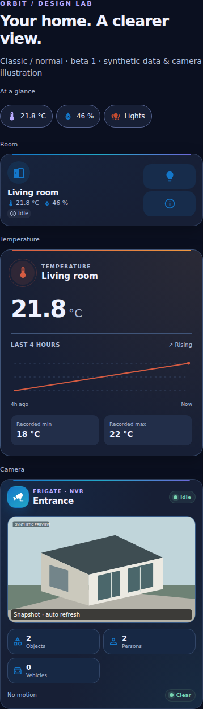
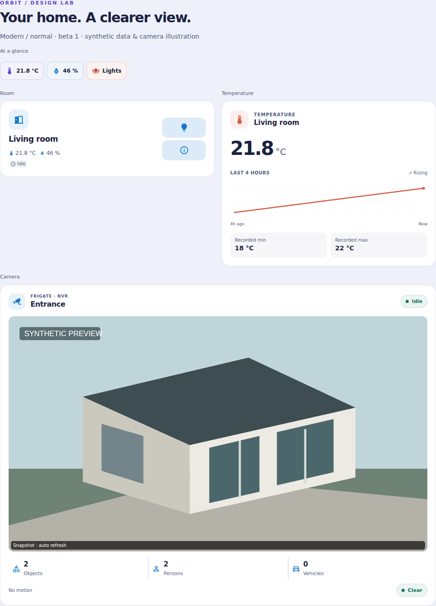

# Orbit Modern — Design Refresh beta

**Available in v1.22.0-beta.1; not promoted to stable.** Modern 0.1.0 is an optional suite-owned presentation for Room, Chips, Temperature and Frigate. The other 33 cards retain their existing design. Classic remains the default on every existing card.

## Visual direction

Clean surfaces instead of layered decorative gradients; quieter borders/shadows; 18px card corners; rounded-square icon surfaces; restrained typography with readable primary values. Existing local palettes and semantic warning/heating/cooling/alarm colors remain meaningful. No web fonts, extra runtime dependency, permanent animation or hover movement.

- **Room:** clearer title/readings, 44px shortcuts and a stacked layout on narrow cards rather than tiny controls. The optional temperature-effect indicator is retained.
- **Chips:** slim rounded rectangles, subtle active-state tint, plain icons and existing name/state choices. The visible capsule remains 40px Normal / 36px Compact inside 48px / 44px touch targets. No outer card frame.
- **Temperature:** a calmer large reading, squared icon surface, lighter graph grid and neutral min/max containers. Recorded data, units, missing states and history requests are unchanged.
- **Frigate:** quieter header, a larger visual emphasis on the camera, thin separated detection readings and preserved status/errors. The frame stays 16:9; image/player/codec behavior is unchanged. This beta does **not** fix H.265/MP4 compatibility or increase a camera's resolution.

Normal/Compact is independent of Classic/Modern. Compact still uses the existing tile and Details behavior; Modern does not force secondary content open or remove warnings/actions.

## Preview

These are **the actual final bundle**, with synthetic entities/history, licensed test-only MDI glyphs and a clearly labelled architectural camera illustration. They are not photos from a real camera, native HA screenshots or physical iPhone certification.

| Modern | Classic comparison |
| --- | --- |
|  |  |




## Install and try

1. Preserve a copy of your dashboard YAML. In **HACS → Orbit Lovelace → Redownload**, enable/select beta versions if necessary and choose **v1.22.0-beta.1**. Stable v1.21.1 remains available; this is not an automatic stable upgrade.
2. Fully reload the frontend/Companion app so the new constructors replace cached ones. Keep the **same single Orbit resource**; do not add standalone resources.
3. Edit one of the four supported cards and select **Card design → Modern · beta**. Keep Card layout Normal or Compact as preferred. For YAML, add `design: modern` to that card.
4. A small generic [demo dashboard](../examples/modern-dashboard.yaml) is provided. Replace example entity IDs and import into a **new empty dashboard**, never over your existing configuration. Importing is optional; existing cards can be edited individually.

```yaml
type: custom:ha-room-orbit-card
title: Living room
temperature_entity: sensor.living_room_temperature
humidity_entity: sensor.living_room_humidity
entity_1: light.living_room
palette: ocean
layout: normal
design: modern
```

Supported types: `custom:ha-room-orbit-card`, `custom:ha-chips-orbit-card`, `custom:ha-temperature-orbit-card`, `custom:frigate-control-card`. Native forms expose the design selector on Room/Temperature/Frigate; Chips has it above its existing visual editor. All other card fields are preserved.

## Reset and rollback

Choose **Classic**, use `design: classic`, or remove `design` to restore the stable appearance. This is a presentation-only switch: it does not recreate card controls/player or request history merely for changing design. A full HACS rollback uses **Redownload → v1.21.1 → full reload**; remove `design` before downgrade for configuration portability. No new resource, themes YAML, HA restart or backend change is needed.

## Verification boundaries

The suite imports/pins, six native modules, Compact runtime/profiles and optional Themes 1.2.0 are unchanged. Modern lives in separately hashed `src/orbit-modern.js` and wraps constructors before registration. CSS attaches to each selected card's shadow root; existing media/controller implementations remain in place.

See [verification](modern-verification.json) for measured coverage. Tests cover stable Classic comparisons, supported themes/layouts/widths, invalid configuration, editor roundtrips, no-query CSS switches, native action/More Info handlers and final-bundle gallery captures. Synthetic tests do not establish native HA editor, Safari/Companion, assistive-technology or hardware behavior. No live HA dashboard, resource, theme or device was changed.
