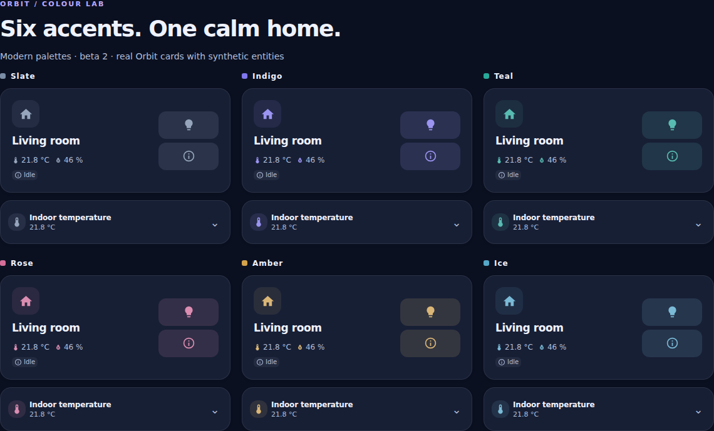
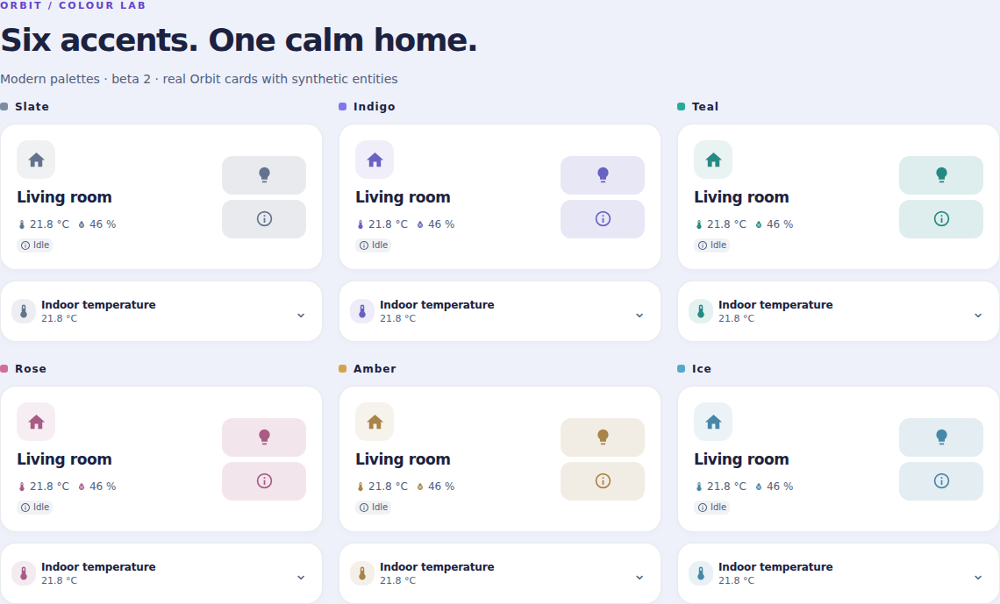
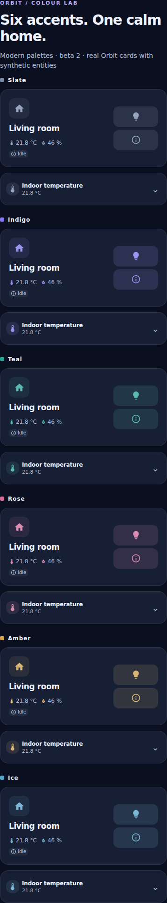
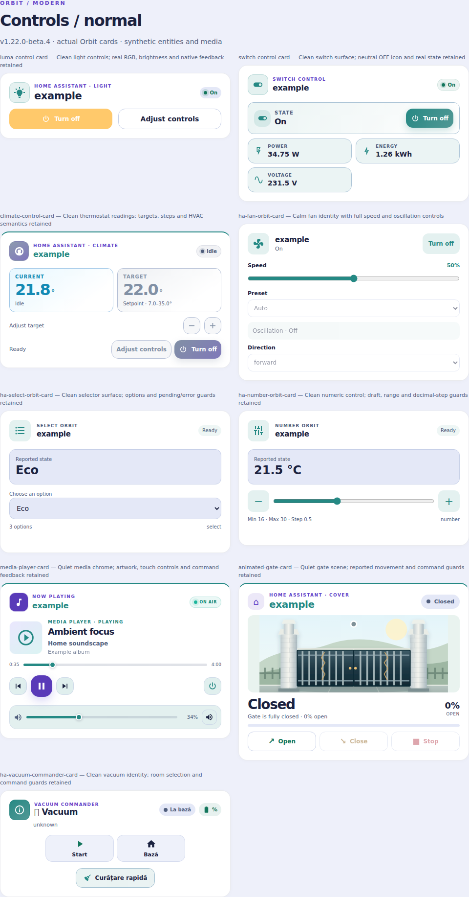
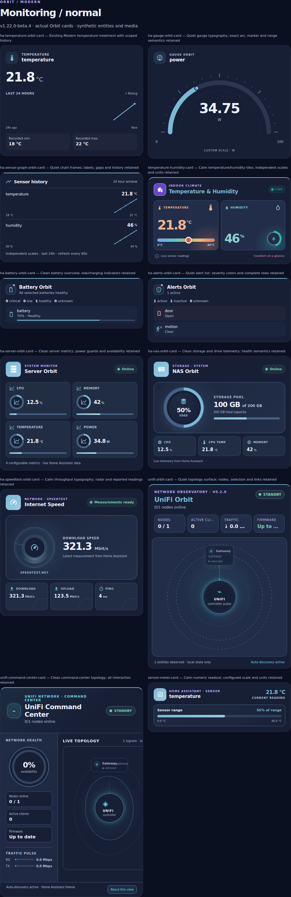

# Modern accent palettes — beta.3

Six additional, restrained color families are available in **v1.22.0-beta.4** on **all 37 primary card types**, in Classic/Modern and Normal/Compact. This is a local card palette, not a new Home Assistant theme. Every card has the palette option in its native or wrapped visual editor and in YAML.

| Key | Direction |
| --- | --- |
| `slate` | cool blue-grey, understated and neutral |
| `indigo` | soft electric violet-blue |
| `teal` | muted jade/green-blue |
| `rose` | dusty pink, not neon |
| `amber` | warm sand/gold |
| `ice` | pale glacier blue |

The original `aurora`, `ocean`, `sunset`, `lavender` remain available and unchanged. Native palette selectors and the Chips collection/per-chip visual editor expose the new values. Leaving the palette unchanged preserves the existing appearance.

## Preview

Color comparison images below are historical beta.2 captures with unchanged colors. The current all-card beta.3 previews follow; these are actual cards with synthetic entities, not hand-built color mockups. Glyphs are licensed test-only MDI; Home Assistant supplies runtime icons.







## Try it

HACS → Orbit Lovelace → Redownload → **v1.22.0-beta.4** (show beta versions if necessary), then fully reload the frontend/Companion app. Same resource; no theme YAML, new dependency or HA restart. Stable Latest remains v1.21.1.

```yaml
type: custom:ha-room-orbit-card
title: Living room
temperature_entity: sensor.living_room_temperature
entity_1: light.living_room
design: modern
layout: normal
palette: teal
```

```yaml
type: custom:ha-chips-orbit-card
design: modern
palette: slate
chips:
  - entity: sensor.living_room_temperature
    palette: ice
  - entity: light.living_room
    palette: amber
    show_state: false
    tap_action:
      action: toggle
```

Palettes decorate identity and controls, not reported values. Room warm/cold overrides, Chips neutral OFF/unavailable and alarm severity colors remain authoritative. Text continues to use theme text tokens; accents adapt to light/dark text color. No synthetic success/online state, actual light RGB change, alarm operation, camera rewrite or additional request is introduced.

## Reset and verification

Choose an original palette before downgrading to beta.2/beta.1/stable; remove `design` before stable rollback. `design: classic` changes the design only, not the chosen palette. No existing YAML is rewritten automatically.

Catalog `src/card-palettes.json` and guarded build adapter `scripts/card-palettes.mjs` are separately hashed. Imported/native source files remain untouched. [Verification](palettes-all-verification.json) records theme/layout/design mounts, narrow parents, contrast measurements for sampled identity icons, semantic state checks, native editors and exact synthetic actions. This is not a general accessibility audit or native iOS/HA certification. No live dashboard/theme/resource/device was changed.

## Complete collection behavior

Beta.3 removes the four-card limitation of beta.2. All 37 primary card types offer the original four families plus the six new families. Existing extra options such as Luma Auto and Pi-hole Rainbow remain available. `design` and `layout` are independent of `palette`.

Cards with a native palette system keep that implementation; guarded build changes extend its validation, selectors and decorative variables before semantic overrides. Cards previously without palettes (UniFi/Command Center, Action, Gate, Climate, Washer, HP Printer, Media and Temperature/Humidity) receive an optional selector and scoped decorative accent frame/title; Media/Action also use their existing decorative accent variable. Reported HVAC/status colors, alarm severity, real light RGB, ink/material colors, temperature/humidity scales and topology health colors are not remapped. Omitted palettes preserve the previous appearance.

Sensor Meter's old `teal` alias now selects the actual Teal family instead of Aurora; use `aurora` explicitly to retain that previous alias appearance. This is an intentional resolution of the name collision.

The optional runtime bridge shares the separately hashed Modern adapter but works in Classic as well. Pure palette switches on the formerly palette-less cards preserve native controls/media. Palette sheet content is cached until the choice changes.

## Beta.3 all-card examples




