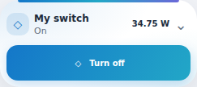
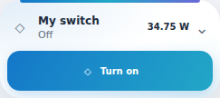

# Switch icon follows reported state — Orbit v1.13.1

For `custom:switch-control-card`, the primary icon now uses the configured palette accent **only when Home Assistant reports `on`**. In `off`, `unknown`, `unavailable` and missing-entity cases, any visible identity icon is neutral (secondary text color, transparent background, no colored shadow). Applies to Normal and Compact. The additional native state icon in Normal follows the same rule. Custom icon overrides are retained.

No new setting is needed. Existing `palette: aurora|ocean|sunset|lavender` and `icon` still apply. Aurora continues to inherit the optional Orbit theme accent according to the existing theme bridge; other explicit palettes retain their existing accent values. The shell, power button, telemetry icons/values and semantic status/error colors are not recolored by this change.

The icon is based on reported state, not requested intent: pressing Turn on keeps the icon neutral through Sending/Command sent until HA reports `on`; pressing Turn off keeps its palette color until HA reports `off`. Service errors do not fabricate a state change. Controls and state updates use the original implementation.

## Install

Update Orbit Lovelace in HACS to **v1.13.1**, then fully reload browser/Companion frontend. Existing YAML is unchanged. No new resource, theme YAML update or HA restart. No live HA configuration or device was changed by publication. Roll back to1.13.0 to restore the old always-colored identity styling.

ON:

OFF:

## Evidence and provenance

Suite-owned guarded/hashed `scripts/switch-state-icon.mjs`1.0.0, traced under suiteFeatures/bundle-lock. Exactly one reported-state data attribute plus targeted icon CSS, applied only to Switch after the theme bridge. Compact specificity is intentionally stronger than its adopted tile stylesheet. All27 imported pins, native Controls1.0.0, presentation0.3.4, Welcome Normal, Luma appearance1.0.0 and Themes1.1.0 remain unchanged.

598 Node tests +2 smoke, syntax/deterministic build;120 final-resource Switch fixtures (2 layouts ×4 palettes ×5 states ×3 widths) and384 theme fixtures (24 modes ×2 layouts ×4 palettes ×ON/OFF), native pending/sent/error state transitions and exact power actions pass. Existing90 all-card identity cases verify3 Switch readings, disclosure, control identity and commands; Luma192 appearance+192 theme regressions and general30-card registration/alias/migration checks pass. The other29 Normal and Compact computed profiles match1.13.0. Light/dark screenshots inspected. Synthetic HA/icons/mocked commands only; native HA/physical Companion/hardware unverified.
