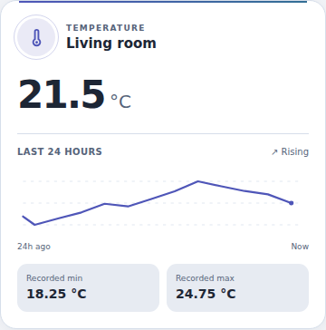
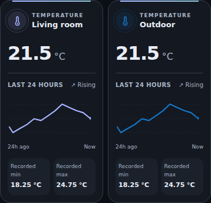
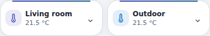

# Temperature Orbit Card

Added in Orbit Lovelace **v1.15.0**, as a suite-owned first-party card. Dedicated to one temperature sensor: no humidity, setpoint, thermostat commands or guessed comfort thresholds. The existing Temperature & Humidity card remains independent and unchanged.

Update Orbit Lovelace in HACS and fully reload the browser/Companion frontend. Add **Temperature Orbit Card** from the card picker, then choose a sensor in the native visual form. Same single resource; no new repository, dependency, theme YAML installation or HA restart. This release does not change a live dashboard or device.

```yaml
type: custom:ha-temperature-orbit-card
entity: sensor.your_temperature
name: Living room
palette: aurora
```

## Design

Normal uses Orbit's accent stripe, circular icon, restrained surface and large temperature readout. A time-scaled history graph, recorded min/max and a simple rising/falling/stable indicator complete the temperature-only view. Aurora inherits the selected Orbit theme; Ocean, Sunset and Lavender provide explicit local palettes. Without an Orbit theme, readable default styling remains. Themes do not change the sensor's reported value.

Compact uses the same suite tile structure: one name/icon/reading, with the graph and min/max behind keyboard-accessible Details. A native **More info** button remains inside Details; Normal opens More Info from the header. No service calls are sent in either layout.





Screenshots use synthetic HA state/history and a local thermometer icon stub, not a live installation.

## Options

| Option | Default | Meaning |
| --- | --- | --- |
| `entity` | empty | A `sensor.*` with `device_class: temperature` or unit `°C`, `°F` or `K`. Nothing is selected automatically. |
| `name` | entity name | Optional display name. |
| `icon` | entity icon / `mdi:thermometer` | Optional namespaced HA icon. |
| `palette` | `aurora` | `aurora`, `ocean`, `sunset`, `lavender`. |
| `layout` | `normal` | `normal` or `compact`, using the suite selector. |
| `show_graph` | `true` | Show recorded history, min/max and trend; false makes a reading-only card with no history requests. |
| `hours` | `24` | History window, integer from 1 to 168 hours. |

```yaml
type: custom:ha-temperature-orbit-card
entity: sensor.your_temperature
name: Outdoor
icon: mdi:thermometer
palette: ocean
layout: compact
show_graph: true
hours: 24
```

The visual selector filters temperature-device-class sensors. YAML also accepts temperature units when an integration omitted device_class. The card rejects other entity domains and refuses to treat a humidity/power sensor as a temperature. Units come from the selected sensor, not the HA display-system preference; there is no implicit conversion. Localized numeric display keeps up to six decimal places. Zero and negative readings are valid. Unknown, unavailable, missing, invalid and disconnected states remain explicit; no fake zero or optimistic value. A temperature-class sensor with no recognized unit can show its reading, but has no history query until its unit is known.

## Recorded history, not an estimate

- Uses HA's authenticated `hass.callApi('GET', 'history/period/...')`, filtered to the chosen entity and bounded to the chosen start/end. No direct server URL or credentials in YAML. Recorder/history permissions and retention determine what data is available.
- Loads one window on connection, then at most once every five minutes; unrelated state updates, layout/theme changes and Details do not trigger extra requests. Compact can cache its history while collapsed. Disabling the graph performs no history queries. Hidden browser tabs pause scheduled refreshes. Detach clears timers and invalidates late responses. The initial in-flight REST request cannot be cancelled by the card.
- A 15-second timeout is visible; an unresolved request cannot overlap another request for the same configuration. Retry becomes available once it settles. Raw backend errors are never rendered. The current reading remains independent of history failure. No automatic device command retries, because this card has no commands.
- Min/max are extrema of available **recorded samples**, not a daily forecast or an assertion of complete coverage. A partial recording window remains partial. A single sample can supply min/max; no trend is claimed from a single sample.
- Unknown/unavailable values and unit mismatches create graph gaps. The request retains attributes for every sample (no minimal_response/no_attributes), so historical unit changes remain detectable instead of being stripped by response compression. Unexpected compressed rows inherit the last known historical unit. Changing entity/unit invalidates cached history and ignores old asynchronous responses.
- The line uses actual timestamps, not equally spaced samples. Empty history has an explicit message rather than a decorative fake graph. No extrapolation to Now or synthesized historic values. The chart bounds visual work with per-time-bucket first/min/max/last points; min/max use all returned matching samples. This is a small overview, not a replacement for native HA History.
- Trend compares first/last recorded samples only when the response has more than one valid sample and no reported gaps. It is not a comfort classification, alarm or future prediction.

## Provenance and rollback

`nativeComponents` records `orbit-temperature` v1.0.0, `src/orbit-temperature.js` and its exact SHA256. There is no invented standalone repository/upstream pin. The existing 27 imported component assets, Orbit Controls 1.0.0, all prior runtime adaptations and Themes 1.1.0 are unchanged. A new per-type Compact profile is traced alongside the existing profiles.

To roll back to v1.14.0, remove or replace Temperature Orbit cards first; that older resource does not register the new type. Existing card YAML/resources otherwise remain unchanged.

## Validation

Behavior tests and final-bundle Chromium checks cover configuration/selector, temperatures/units/locales, scoped history throttling, missing/error/timeout/retry, stale responses, unit-change invalidation, unknown gaps, min/max, bounded rendering, safe text, More Info, themes and Normal/Compact phone grids. Native HA visual-form rendering, a real Recorder transport and physical Companion/Safari remain unverified. No live HA, camera, thermostat or dashboard was modified.

Researched API: [Home Assistant REST history contract](https://developers.home-assistant.io/docs/api/rest/#get-apihistoryperiodtimestamp). The native visual-form and suite Compact interfaces follow the existing first-party Orbit Controls integration.
