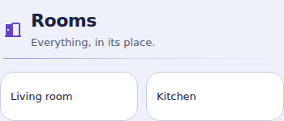
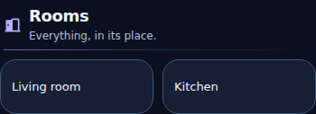

# Title Orbit Card

Suite-owned **Title Orbit1.0.0**, included in **Orbit Lovelace1.20.0+** as `custom:ha-title-orbit-card`. A lightweight, static section heading with the same Orbit palette/theme design. It is not an entity card, button, navigable link or Markdown/template renderer.

## Install

Update the existing Orbit Lovelace HACS Dashboard installation and fully reload every browser/Companion frontend. In Add card choose **Title Orbit Card**. Same resource: `/hacsfiles/orbit-lovelace/orbit-lovelace.js`. No separate repository/resource/dependency, theme YAML update, HA restart or backend integration. No live dashboard is modified by installing/updating the suite.

```yaml
type: custom:ha-title-orbit-card
title: Rooms
```

Optional subtitle/icon and Compact layout:

```yaml
type: custom:ha-title-orbit-card
title: Rooms
subtitle: Everything, in its place.
icon: mdi:home-outline
palette: lavender
layout: compact
separator: true
heading_level: 2
alignment: start
```

## Design

Transparent/unframed by default, with no large background panel or icon disc. The heading uses primary text, the optional subtitle secondary text; icon and optional thin gradient divider use the local Orbit accent. Aurora inherits the active Orbit theme, including Prism, while Ocean/Sunset/Lavender retain explicit accents. No optional theme is required.

Normal uses22px/28px heading,13px/19px subtitle,24px icon and12px vertical padding. Compact keeps the same content/semantics at18px/24px,12px/17px,20px icon and6px vertical padding. It is already a heading, so Compact does not add a synthetic tile, state, duplicate name or Details arrow. It does not require44px touch targets because it has no interactive controls. Long headings/subtitles wrap rather than hiding information; logical alignment and automatic text direction support translated/RTL content.




The two room placeholders below the preview heading are illustrative, not extra cards shipped by Title.

## Options

- `title`: nonblank plain text, default `Rooms`. No automatic entity discovery or templating.
- `subtitle`: optional plain text, default empty. Newlines are preserved; blank-only values hide it.
- `icon`: optional native HA icon such as `mdi:home-outline`; empty hides it. No replacement image or runtime icon dependency.
- `palette`: `aurora` (default), `ocean`, `sunset`, `lavender`. Changes only decorative accent, not heading readability or semantic state colors on other cards.
- `alignment`: `start` (default), `center`, `end`. Uses logical direction, not fixed physical left/right.
- `separator`: boolean, false by default. Shows a subtle1px accent divider.
- `heading_level`: integer1–6, default2. Renders an actual `h1`–`h6`; visual font size is still controlled by layout, not the semantic level. Choose a level appropriate for your dashboard heading hierarchy.
- `layout`: `normal` (default) or `compact` via the suite editor selector.

All supported fields are available through the native visual configuration form. Text is inserted as text, never HTML/Markdown. No entity, action/service, navigation, state display, history, subscription, timer, authentication or network query is introduced. Extra entity/action keys do not add behavior; they are outside this card schema. Ordinary HA updates and layout-only changes preserve the heading DOM.

## Verification and limits

[Verification evidence](title-verification.json):43 dedicated Node tests,768 final-bundle theme/layout/palette/width mounts,12 actual360/390/430px phone section fixtures, semantic heading levels, localized/RTL/long/hostile text, native form schema/labels, stable updates and no controls/services/queries. Suite regressions and unchanged existing-card executable/provenance checks are separate. Browser previews use synthetic HA/forms and an actual test-only MDI icon path; native HA editor, Safari/Companion and assistive-technology behavior remain unverified. No live HA/dashboard/theme/device changed.

Before rollback to1.19.2 or older, remove/replace Title instances because those releases do not register this new type. Existing33 card types/options and resource URL remain unchanged.
